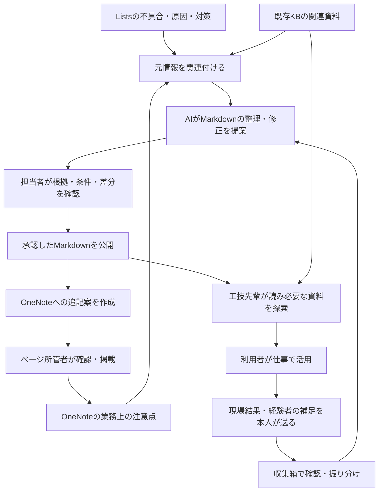

# 工技先輩と、現場の経験からノウハウが育つ仕組み

> 2026-10-19時点の会話の総括と提案。読み手は構想を検討する担当者・開発者。
> 利用者の希望、設計上の推奨、未確認事項を区別する。実装・接続・本番公開を承認した記録ではない。
> 技術契約の詳細は[既存の設計ドラフト](./design-2026-10-01-knowhow-flywheel.md)を参照。本書は目的、利用体験、改善案、進め方を整理する。

## 0. まず管理者へ読み取り連携を相談する

> 最終検証: 2026-10-19 — 利用者の指示に基づく次の行動の整理。権限申請・管理者への連絡・接続検証は未実施。

最初の行動は、OneNote・Microsoft Listsの読み取り連携に必要な権限を、管理者へ相談すること。itaiさんと相談先・対象を確認し、対象ノート / セクション・リストを絞った読取で始める。管理者本人への連絡はこのPRでは実行せず、相談内容を共有する。

管理者へ伝える相談文のたたき台:

> OneNoteの業務上の注意点とMicrosoft Listsの不具合・原因・対策を、既存の技術資料と照合し、担当者が確認するノウハウMarkdownへ整理したいと考えています。
> まずは対象を限定し、内容を読み取る連携に必要な権限・アプリ登録 / 同意・認証方式をご相談したいです。必要な本文・表・画像 / 添付と、元ページ / 項目へのリンク・更新情報を確認できる範囲を教えてください。
> OneNote・Listsへの自動書込は求めません。OneNoteへの追加は、担当者がKBとの照合結果・未確認点を含む追記案を確認し、コピーして手動で行います。
> 読取に加え、取得物の保存場所・保持期間、ローカル / 共有AIへ入力してよい範囲、整理した知識を共有できる読者と、元情報の変更・撤回時の扱いも確認したいです。

確認したい事項は、対象ノート / リストと所管、必要な利用者・アプリの読取権限、許可された認証方法、取得・AI入力・派生知識の共有条件、窓口と次の手順。全テナントの読取や利用者本人への管理者権限付与を前提にせず、OneNoteとListsの権限方式も一括で決めつけない。

申請の相談を先に進めつつ、許可済みの既存取得物での整理・画面検討は継続できる。権限付与を受ける前に接続・取得範囲を広げない。構想全体の実装、検索対象の追加、AI入力先や保存先の採用は、この相談と別に共同確認する。

## 1. 目指す体験

利用者が工技先輩に相談すると、整理済みのノウハウと関連資料を探して、確認すべきことが分かる。現場で試した結果や経験者の補足を短く残すと、担当者が確認し、次の人が使うMarkdownへ反映される。みんなに知らせたい内容は、普段見ているOneNoteにも戻せる。

この循環を、**現場の経験を収集し、確認した知識を育て、次の仕事に使える形で返す仕組み**として作る。

例えば、以下は動きの構造を示す架空の例であり、実際の技術的な助言ではない。

1. 利用者が、ある症状について相談する。
2. 工技先輩が関連Markdownを読み、適用条件を確認し、必要な資料を既存KBから探す。
3. 利用者が現場で分かった結果を「実際には条件が違った。別の対応で変化があった」と残す。
4. AIが観測結果、対象条件、理由の仮説、不明点を分けて整理する。
5. 担当者が根拠と範囲を確認し、既存Markdownに条件差や注意点を追記する。
6. 新しい注意点をOneNoteへ掲載する案を作り、ページ所管者が確認して追記する。
7. 次の相談では、改訂したMarkdownと根拠を使って、前回より条件の合う情報に到達する。

「強化された」と判断するのは、文章やファイルが増えた時ではなく、次の人が必要な条件・根拠・確認先へ早く到達できた時である。

## 2. これまでの希望から確認できたこと

| 利用者の説明・希望 | 設計に含めること |
|---|---|
| 業務の多くをOneNoteにまとめている | 既存の原記録と日常の閲覧習慣を活かす |
| Listsには不具合の内容・原因・対策まである | リンク集として扱わず、列に残った本文と事例条件を使う |
| 現在はローカルへ取得し、生成AIで体系化している | 今の取得と整理を出発点にし、自動連携を試行の必須条件にしない |
| ObsidianのMarkdownをknow-howにしたい | Markdownをチームの整理済みノウハウの本文として育てる |
| フロントエンドで担当者が確認し、AIでMarkdownを編集したい | 元情報、本文、AI差分を並べ、手動編集と確認・承認を可能にする |
| 既存ナレッジベースからも持ってきたい | 資料検索と根拠選択を、作成時と相談時の両方で使う |
| 工技先輩がMarkdownを確認しながら必要な情報を探したい | Markdownを読み、その条件・用語・出典から不足する根拠を探す |
| ノウハウを収集し、Markdownを継続的に強化したい | 現場の結果、経験者の補足、訂正、未解決事項の収集経路を作る |
| みんなが見るOneNoteにも逆に追記できる情報を集めたい | 確認した知見の追記案を作り、所管者がOneNoteへ還元できるようにする |
| OneNoteへの自動追記はまだ不要。担当者が確認して追加しやすくしたい | 貼り付け用の追記案・編集・根拠確認・コピーを支援し、実際の追記は担当者が行う |

ObsidianのMarkdownをチームのノウハウ本文として扱い、共有対象は頻出テーマだけに限定しない。重要な注意点、条件の違い、教育・引継ぎ、低頻度でも失うと困る知見も対象になる。

Markdownはノウハウ本文である。内容を読まずに参照先だけを辿る索引に縮小しない。一方、正式な仕様・基準・所管の判断をMarkdownだけで変更するものでもない。

## 3. 全体をつなぐ循環

入口は「既存資料」と「新しく得られた経験」の二つ。出口は「工技先輩を通じた利用」と「OneNoteでの共有」の二つ。その間に、同じMarkdownを育てる編集・確認の経路を置く。

## 4. 各道具の役割と、更新する場所

| 場所 | 主な役割 | そこで変更する内容 |
|---|---|---|
| Lists | 不具合事例の原記録 | 個別事例の内容・原因・対策・結果の訂正や追記 |
| OneNote | 業務記録、注意点、日常の共有 | 原記録の更新と、確認済み知見の共有用追記 |
| 既存KB | 関連する技術資料を探す入口 | 元資料の所管に従って更新。ノウハウ編集から勝手に書き戻さない |
| Markdown | 事例を横断したノウハウ本文 | 確認順、条件差、例外、出典、経験者が確認した知見 |
| Obsidian | Markdownを整理・編集する環境 | 同じ管理対象のMarkdownに対する修正案 |
| 担当者Web画面 | 収集、根拠照合、AI編集、確認・公開 | 下書き、修正案、承認、掲載先への反映記録 |
| 工技先輩 | 相談を受け、知識を読み、資料を探す入口 | 回答と収集用の整理案。共有本文は独断で変更しない |

ノウハウ本文の編集正本は一つにする。会社が認める非公開GitでMarkdownを版管理する案を推奨するが、利用できる保存先は未確認。WebとObsidianを別々の正本にしない。

OneNoteには必要な注意点や要点とMarkdownへの参照を戻す。詳細の全文複製を常に作る運用は避ける。OneNoteの原記録は原記録として残し、どの情報をどこで訂正するかを明確にする。

## 5. 工技先輩が担う三つの仕事

### 5.1 相談の目的を整理して、探す

対象機種、症状、作業条件、知りたいことを整理する。最初に関連Markdownを読み、必要な前提と出典を把握する。足りない情報は本人が閲覧できる既存KBで探し、条件が違う資料を混ぜない。

Markdownに記載がなくても資料検索へ進む。逆に記載があっても、正式な仕様値等は原資料の該当箇所と現行性を確認する。検索回数・時間・取得量には上限を置き、到達できない時は不足を具体的に伝える。

一般利用者向けの初期探索は、公開済みMarkdownと許可された既存KBに限る。編集担当向けのLists / OneNoteの取得物を、そのまま全員の検索対象にしない。直接参照が必要ならMicrosoft認証付きリンクへ案内する。これは初期実装の推奨であり、将来の資料単位の読取連携を否定するものではない。

### 5.2 結果と経験を聞き取り、残す

利用者が「対応結果を残す」「注意点を追加」「この条件では違う」を選んだ時、短い入力を知見の候補へ整理する。質問に答えられなかった場合も、何が分かれば解決できたかを残せるようにする。

全ての利用者に長いフォームを要求せず、最初は「何が分かったか」「どの条件か」を短く受け付ける。会話の情報から候補を埋め、送る内容を本人が確認する。元会話の全文や顧客情報を自動で収集箱へ複製しない。

本人が送った原文、AI整理案、本人が確認した版を区別し、観測日時・条件・共有可能な範囲と結び付ける。投稿者が送信したことを、全員が見るOneNoteへの再配布許可と解釈しない。

### 5.3 整理して担当者に渡す

同じテーマの候補をまとめ、既存Markdownへの追記か、新しいテーマか、原記録を直すべきかを提案する。AIが考えた原因と本人が観測した事実を混ぜない。根拠不足や矛盾を隠さず、担当者が判断するための差分を作る。

この三つを、一つの利用体験の中で役割を切り替えて実現する。初期から別々の自律エージェントを多数配置する必要はない。閲覧と編集・承認の権限はサーバー側で分ける。

## 6. 収集した情報を知識へ変える

収集直後の候補は、まだチームの確認済みノウハウではない。次の区別を保つ。

| 段階 | 例 | 扱い |
|---|---|---|
| 観測・報告 | ある条件で対応後に症状が変わった | 当事者・日時・対象条件とともに残す |
| 解釈・仮説 | 変化の理由はこの要因かもしれない | 仮説と明示し、原因として確定しない |
| 適用範囲の確認 | どの条件で使えるかを所管者が確認した | 確認した範囲と根拠をMarkdownへ反映 |
| 公開済み知識 | 特定版が読者向けに公開された | 工技先輩の回答に使用できる |
| OneNoteへの掲載 | 正確な追記文と掲載先を確認した | 転記した版・ページ・確認日を追跡する |

収集箱は一つにし、候補ごとに担当・状態・不足条件・採否・反映先を見られるようにする。改善要望、回答品質の問題、技術的な知見を種別で分け、技術知見を単なる要望本文に埋もれさせない。

状態は「未確認」「確認待ち」「反映済み」「保留 / 不採用」程度から始める。Markdownの下書き・承認・公開、OneNoteへの掲載状態とは別に扱う。状態を細かく作りすぎず、何が誰待ちかが分かることを優先する。

未解決の候補は担当、必要な回答、再開条件を残す。回答が分かった時は同じ候補を開いて追記する。新しい通知システムを作る前に、収集箱の一覧から担当者が追える形を試す。

採用しない判断にも理由を残す。重複なら既存知識へ案内し、根拠が足りなければ不足を示し、原記録の誤りなら所管へ戻す。送った人が、自分の補足がどう扱われたかを画面で確認できる形を推奨する。

## 7. 担当者画面で行うこと

基本は「収集・ノウハウの一覧」と「詳細・編集」の二つ。収集箱を一覧内のタブとして扱い、別の管理アプリを増やさない案を推奨する。

| 画面の領域 | 確認・操作 |
|---|---|
| 元情報 | Lists / OneNote / KB資料、投稿者の報告、該当箇所、版、適用条件 |
| Markdown本文 | 手動編集、プレビュー、以前との比較、確認済み点と未確認点 |
| AI支援 | 関連事例の候補、追記案、不足条件、矛盾候補、変更理由、採用 / 修正 / 却下 |
| 確認と反映 | 下書き保存、確認依頼、承認 / 差し戻し、公開 / 停止、OneNote追記案と反映結果 |

AIへの指示は「この節に条件差を足す」「原資料と矛盾する箇所を挙げる」のように範囲を絞る。提案を採用する前に人が本文を直していたら、自動適用せず再比較する。

担当者にGit操作を求めない。Obsidianのローカル編集も基準版付きの修正案として同じ経路へ戻す。ブラウザーが端末の任意のVaultを自由に上書きできる前提にはしない。

## 8. OneNoteに戻すものと、戻し方

> 最終検証: 2026-10-19 — 追加済み記録時の掲載先・転記した版の必須化を設計書§14.7とそろえた。実データでの貼り付けは未検証。

OneNoteに戻す価値があるのは、日常の確認漏れを防ぐ注意点、複数事例を見て分かった条件差、調査の入口となる短い案内など。投稿やAI回答をそのまま全件転記しない。

追記案の例は「追加で分かったこと」「対象条件」「注意する例外」「確認日・確認者」「詳細・根拠へのリンク」。機密範囲によってはタイトルやリンクの存在自体も転記しない。

追記元は承認済みMarkdownの特定版に固定する。OneNote用にAIが短縮・言換えした文章は、その正確な文と掲載先を所管者が確認する。同じ人が技術確認と掲載先確認を兼ねられる場合は、画面を行き来せず一度に確認できるようにする。

追記の検討時も、許可された既存KBの関連資料を照合する。「既存資料にあること」「追加する経験・条件差」「食い違い・未確認点」を根拠の版・該当箇所と並べて示す。既存資料で十分なら短い案内とリンク、新たな知見があれば追加の注意点、矛盾があれば所管者への確認を提案する。担当者はこの比較を見て、追記するか、何を書くかを判断する。

KBに一致する記述がない新しい経験も収集できるようにする。未取得・検索不一致を「KBに記載なし」「誤り」と断定せず、確認できた範囲と不足を示す。同じ資料版に対する承認時の照合結果を再利用し、内容や根拠が変わった部分を再確認する。OneNote現行ページとの重複確認は、KB照合とは別に行う。

利用者の明示した方針として、現段階の対象は担当者が確認して追加しやすい支援までとし、自動追記・API書込は含めない。有用性の確認後に自動追記へ移る予定も置かず、必要になった時に別途検討する。

画面では「追記案」「根拠・適用条件」「貼り付け用プレビュー」を見比べ、担当者が文章を直せるようにする。見出し・箇条書き・出典リンクを整え、確認した文をコピーできるようにする。短い要点と、必要な注意点を含む文章から選べる案とし、コピー用に原文のMarkdown記号を自分で整形する負担を減らす。装飾付きコピーは貼り付け確認を行い、使えない環境にはプレーンテキストを用意する。

担当者は必要に応じて貼り付け先のOneNoteを開き、追記する。先に本文を取得できていなくても案の作成・確認・コピーを使えるようにし、ページID入力やOneNoteの書込連携を前提にしない。元ページの表示が取得済みスナップショットの場合は取得時点を明示し、現行内容の確認は本人がOneNote側で行う。

「コピー済み」と「OneNoteへ追加済み」を分ける。担当者が実際の貼り付けを確認して追加済みを記録する。追加済みを記録するときは、反映先ページを特定できる情報（リンク等）と、転記した版を必ず残す。追記案の作成・確認・コピーは、掲載先が未定でも利用できる。これは担当者による記録であり、システムがOneNoteを更新・検証した表示にしない。コピー後に追記案が変われば、その新しい版まで追加済みとは扱わない。この機能のためのOneNote書込権限は求めない。

転記した後も保守は続く。Markdownの訂正・撤回時は該当OneNoteを逆引きして、所管者による訂正完了まで追う。OneNoteで直接編集された内容は修正候補として比較する。自システムからの転記が再収集された時は、新しい独立証拠や多数の支持として数えない。

詳細対策をOneNoteに掲載する場合は、旧区画の廃止・差替えと訂正期限を所管者と決める。新しい文を追記するだけで古い対策が残る状態を避ける。人手のコピーで転記識別子が消える可能性もあるため、文章の類似だけで独立した根拠の数を増やさない。

## 9. 問題になりやすい点と対策

| 問題 | 起きること | 推奨する対策 |
|---|---|---|
| 入力する負担 | 相談は使われても結果が残らない | 相談文脈を引き継ぐ短い結果入力。送信は本人が選ぶ |
| 確認待ちの滞留 | 詳しい人の仕事が増え続ける | 担当と代替担当、差分だけの確認、不足理由の見える化、処理できる範囲のテーマ数 |
| 一件の成功の一般化 | 別条件でも同じ対応が使えると誤解される | 観測と仮説を分け、適用条件・除外条件を本文に残す |
| AIの提案の自己承認 | 作文が検証済み知識に見える | 根拠と確認者を結び付け、AI案だけで公開状態にしない |
| 多重転記と循環 | 同じ知見が別々の証拠に見える | 出典IDと転記ID、派生関係、独立した観測かを確認 |
| MarkdownとOneNoteの食い違い | 古い注意点が残る | 正本と掲載版を識別し、転記先の更新・撤回まで追跡 |
| 読者の違い | 限定資料の内容が広いOneNoteへ出る | 掲載先の読者全体への共有許可を別に確認 |
| 取得物の欠落・古さ | 表や画像の条件を落とす | 取得時点・不足を表示し、必要な根拠を確認できるまで保留 |
| 保存先・AI利用先の不一致 | ローカルで扱えた資料を無許可でクラウドへ送る | 会社が認めたモデル入力・保存先・読者範囲を先に確定 |
| 結果の未記録 | 再利用の効果を判断できない | 結果を残せなかったケースも含め、利用・確認負担を測る |

承認の回数だけを増やしても信頼性は上がらない。意味が変わる箇所は分野の確認者が見て、書式や取得日時だけの機械処理は繰り返し専門家へ回さない。一方で、公開先や読者が変わる判断は技術内容の承認と区別する。

## 10. 追加するとよいアイデアと優先度

以下は利用者が確定した要件とは別の、追加提案である。効果は実利用で検証する。

| 優先 | アイデア | 狙いと、最初の小さな形 |
|---|---|---|
| 先に試す | 相談後の「結果を残す」 | 前提情報を再入力せず、実際に分かったことだけを残す。解決・未解決の選択だけで原因を確定しない |
| 先に試す | 「失敗したこと・使えなかった条件」も収集 | 成功例だけで一般化しない。条件違いの補足を既存Markdownへ足す |
| 先に試す | 投稿者に反映先が分かる | 採用先・保留理由を収集箱で確認でき、投稿が消えたように感じさせない |
| 先に試す | 不足に応じた短い聞き取り | 全件同じ長文フォームを埋めさせず、対象や結果等の不足だけを質問 |
| 先に試す | 一テーマ一枚の確認画面 | 根拠・差分・適用条件・公開先を同じ画面にまとめ、確認の往復を減らす |
| 小さく試す | 調べても分からなかった事項の一覧 | 未解決の相談から、資料の欠落と検索の問題を分ける。候補の多さを正しさや重要性に直結させない |
| 小さく試す | OneNote掲載済み・更新必要の表示 | どこにどの版が出ているかが分かり、訂正先を探す手間を減らす |
| 後から検討 | 経験者の聞き取り支援 | 担当者が選んだテーマについて、確認順や失敗例を対話で引き出す。録音や音声導入は別途必要性を評価 |
| 後から検討 | 更新差分の自動発見 | 取得や更新確認が主な負担と分かった場合にGraph等を追加。自動反映まで一緒に許可しない |

導入時は、投稿件数ランキングや作成ノルマを設けない案を推奨する。重要な一件、否定的な結果、保留判断も役立つため、量を競わせると目的とずれるおそれがある。

## 11. 現行実装との距離と、構成の推奨

2026-10-19にローカルHEAD `32a5905c64be9e1551ab515befed20d66ae68fef` の関係ファイルを確認した。デプロイ状態とAWS上の動作は未確認。

| 確認した接点 | 活かせること | 新たに必要なこと |
|---|---|---|
| RAGの検索関数 | 既存KBの検索を探索部品にできる | 工技先輩の探索制御、公開Markdownの版・読者検証、根拠表示 |
| お知らせのMarkdown編集・プレビュー | 入力・表示のUIパターンを参考にできる | ノウハウ専用の差分、AI支援、版競合、確認と承認 |
| `/chat/suggestions` と改善提案の集計 | 投稿や振り分けの入口を参考にできる | 技術知見の項目、担当・状態、根拠・改訂・掲載先の対応 |
| admin向けの画面制御 | 認証済み画面の構成を参考にできる | 業務の編集者・確認者の権限。全員にadminを渡す構成にはしない |

既存RAGにはMarkdownを資料候補・引用表示から除外する処理がある。単に`.md`を追加して終わる機能ではない。既存の要望保存も、そのまま技術知見の収集・承認台帳になっているわけではない。詳細な接続点と否定テストは[設計書§10・§15](./design-2026-10-01-knowhow-flywheel.md#10-既存コードとの接続箇所)を参照する。

推奨する責任の分け方は、既存EleKnowledgeに利用者の相談・収集と担当者の編集・確認画面を置き、裏側の知識管理、収集記録、検索公開を接続する形。業務知識そのものをアプリ開発リポジトリへ混ぜない。

現在のローカル生成AIとObsidianは、取得資料の整理・下書き作成に引き続き使える。共有フロントエンドからのAI編集を、利用者のPCで処理するか、会社が認める共有実行環境で処理するかは未決。ブラウザーのボタンが任意のPCのローカルAIへ自動接続できると仮定せず、実行場所・認証・送信できる資料・費用負担を選定する。

既存のBedrock利用を参考にできても、OneNote / Listsの本文を同じモデルへ渡せる許可があるとは限らない。モデル名や保存先を先に固定するより、入力許可と運用負担を確認してから接続方式を決める。

## 12. 最初に完成させる一往復

収集箱だけ、チャットだけ、資料取込だけの個別試作で終わらせず、一つのテーマで次の流れを通す。

1. 既存Markdownと、その根拠となるLists / OneNote / KB資料を選ぶ。
2. 工技先輩の限定試行で、Markdownを使う相談と原資料の追加検索を行う。
3. 利用者が結果または補足を短く送る。
4. 担当者が収集箱で振り分け、AI差分と根拠を確認してMarkdownを改訂する。
5. 確認した版を公開し、次の相談で新しい条件・注意点が使われることを確認する。
6. OneNoteへ戻す価値がある内容を追記案にし、所管者が手動で反映し、反映先を記録する。
7. 模擬的な訂正を一件入れ、MarkdownとOneNoteの両方を追跡・訂正できることを確かめる。

代表テーマは少数から選ぶ。頻出、条件差のある事例、重要な注意点を含む組合せを候補とするが、正式な安全作業の判断を最初の試行へ持ち込まない。実データの利用と公開範囲は共同確認して選ぶ。

Graph自動取得・OneNoteへのAPI追記、任意Vaultの自動同期、高度な知識グラフ、モデルの追加学習、無人で継続実行する多数のAgentは、その一往復が回る条件にしない。

## 13. 効果を見て、次の投資を決める

| 見ること | 記録する内容 |
|---|---|
| 探す負担が減ったか | 根拠と必要条件に到達するまでの時間、問い合わせの往復、未到達理由 |
| 経験を残せたか | 利用に対し結果が残った数、入力時間、送信しなかった理由。不明なら不明と記録 |
| 確認が回ったか | 確認待ちの理由・滞留時間、編集・所管確認の作業時間 |
| 次の人に役立ったか | 改訂後の実際の再利用、条件違いによる保留、誤った断定や手戻り |
| OneNoteへ返す意味があったか | 掲載先、読者の利用例、転記と訂正に要した時間 |
| 維持できるか | 担当不在時の引継ぎ、取得・公開・失効対応、AIと保存の費用 |

小さな試行で良い結果が出ても、全テーマの正確性や費用対効果の証明にはしない。特定担当者に作業が集中する、OneNoteの複製維持が負担になる、結果が収集できない場合は、その原因を直してから範囲を広げる。

## 14. 希望・推奨・未確認事項の境界

| 区分 | 内容 |
|---|---|
| 会話で確認できた希望 | 既存資料と現場知見の収集、Markdownの強化、担当者のAI編集・確認、工技先輩の探索、OneNoteへの還元 |
| 今回の推奨 | 一つの収集箱、短い結果入力、単一の知識正本、公開版のみの探索、差分での確認、OneNote追記案から始める段階導入 |
| 実物で確認が必要 | 元データの構造・画像・添付、既存Markdownの品質、KB資料と版の解決、読者範囲、担当と代替担当、AI入力の許可、共有保存先 |
| 接続前に確認が必要 | 元情報の読取連携を行う場合のMicrosoftアプリ登録・同意・委任認証・対象範囲、共有AIの実行場所、AWSの権限と既存利用者への影響。OneNoteへの書込連携は現段階の対象外 |
| まだ実施していないこと | アプリ実装、実データ取込、Vault変更、Microsoft / AWS接続、OneNote書込・デプロイ |

次の具体化では、代表のMarkdown一件と対応する元情報を許可された環境で見比べ、「相談→結果入力→確認→改訂→OneNote追記」の画面と操作を一件分つなぐ。推測の資料件数・更新頻度・確認工数で本実装の見積りを固定しない。

## 15. 根拠と確認範囲

- 利用者の希望はこの会話の説明を根拠にした。過去の説明に追加された希望も含め、個人メモ限定・頻出限定という以前の解釈を修正した。
- 技術的な版管理・公開・認可・取込・OneNote還元の契約は[既存設計書](./design-2026-10-01-knowhow-flywheel.md)へ集約する。同じ仕様を別の正本として管理しない。
- ローカルコードの限定確認は§11の範囲。実データ、実テナント、本番動線、効果は未検証。
- OneNoteの更新方法とAPI概要の公式文書は2026-10-19に再確認した。技術的に更新手段があることと、この会社で利用できることを区別する。
- 価値・運用・信頼性の複数の観点で設計を点検した。複数AIの検討は、資料所管者の確認や現場での有用性の検証を代替しない。
