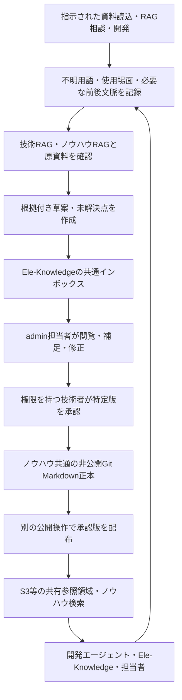

# 初期構想: 製品用語と基礎知識をAIと共有する

## 解決したい困りごと

当社製品の専門用語・略称・現場の通称は、AIが事前学習で知っていることを前提にできない。資料が検索できても、その用語が何を指すか、別の機種でも同じ意味か、取得した説明をどこまで使えるかを判断しにくい。

調査のたびに同じ説明をやり直すことを減らし、確認した知識を次の開発・相談へ引き継ぎたい。開発エージェントとEle-Knowledgeのエージェント・RAGが、共通の根拠付き知識を参照・加工できるようにする。

本書は方向性を共同確認する初期構想。データ構造・バケット構成・実装方式は未確定であり、このPRではAWSリソース作成、資料登録、KB取込、検索対象の変更を行わない。

## 管理方針: ノウハウの一種として、一単元ずつ育てる

用語解説と、その意味を理解するための基礎知識を、ノウハウと共通のMarkdown・編集正本・承認・版管理・公開経路で管理する。既存の`case_summary` / `practice_guide`に加え、「用語・基礎知識」という分類を持たせる。分類の機械用識別子は詳細設計で決める。人も閲覧でき、若手担当者の学習・引継ぎにも利用できる知識とする。一単元は「ひとつの用語と、その仕組み・対象条件を理解できるまとまり」とし、必要に応じて単元同士を関連付ける。

例えば「BKという呼称」「ブレーキの状態と運転条件」「商品名・機種コード・制御方式の対応」などが候補になる。これは題材の例であり、用語の意味・仕様・操作を本書で確定するものではない。

| 単元に持たせたい情報 | 内容の例 |
| --- | --- |
| 用語と別名 | 正式名称、略称、通称、表記ゆれ、混同しやすい言葉 |
| 意味と仕組み | 何を指し、他の部品・信号・制御とどう関係するか |
| 対象条件 | 機種、制御方式、年代、版による違い、適用できない条件 |
| 根拠 | 原本の文書番号・版・ページ、技術者からの説明と確認日 |
| 確認状態 | AIの仮説、技術者説明、原本で確認できた事実、未確認事項 |
| 関連する知識 | 別単元、参照すべき資料、次に確認する点 |

同じ単元でも、主張ごとに確認状態が違うことを許容する。技術者の説明は出所付きで残し、AIの推測や原本照合済みの事実と区別する。AIが同じ説明を何度参照しても、それだけで確かさを上げない。

## 大まかな構成案

> 最終検証: 2026-10-21 — ユーザー指定と既存ノウハウ設計§14.6・§15を照合。画面・API・AWSの実装と動作確認は未実施。

### 不明点の収集と草案化

資料読み込みを明示的に指示されたとき、またはRAGチャット・開発中に用語理解や辞書の不足が確認できたとき、不明用語を候補として登録する。用語、使用場面、必要最小限の前後文脈、出典・版・該当箇所、何が不明かを残し、意味を推測で確定しない。単なる未検索と、検索したが見つからなかった状態を区別する。

候補に対し、許可された技術RAG・ノウハウRAGと原資料で後から根拠を調べ、解説のたたき台を作ってインボックスへ投函する。資料間の矛盾、機種・版の条件、未確認点、検索で見つからなかった点を残す。既存の同一用語・単元がある場合は新しい辞書を増やさず、既存単元への修正候補に関連付ける。AIの草案や過去の生成回答を、それ自体で独立した正解の根拠にしない。

文脈の保存・モデル入力・管理者への共有は元情報の許可範囲内とし、個人情報や秘匿情報、会話全文を無条件に収集しない。検索・生成の起動方式、費用上限、停止条件、未処理候補の重複抑制は詳細設計で決める。

### Ele-Knowledgeの共通インボックスと権限

インボックスはEle-Knowledge側に構築し、ノウハウの候補・指摘と共通の収集箱で扱う。Cognito User Poolの`admin`グループに属する利用者が参照できる方針とし、一覧・候補本文・根拠・差分を管理画面で確認し、補足・修正・保留・差し戻しを行えるようにする。候補の状態、担当、確認待ちの理由、採否、反映先の単元と版を追跡する。

画面の表示制御だけに依存せず、API Gateway / Lambda側で検証済みJWTの`cognito:groups`と操作者IDを用いて認可する。非adminが直接APIを呼んでもインボックスの一覧・本文・根拠を取得できないことを実装時に検証する。個人のチャット履歴の本人分離は維持し、admin所属を全チャットや権限外原本の閲覧許可にしない。

インボックスを参照できることと、技術内容を承認・公開できることは分ける。承認・公開の業務権限は既存ノウハウ設計に接続し、役割の割当を詳細設計で決める。AI・開発エージェントからの候補登録も、認証された限定的な経路を別途設計し、AIへadmin利用者の資格情報を渡さない。

### 編集正本と共有参照先

編集正本はノウハウと同じ非公開GitのMarkdownに統一し、Webの補足・修正・確認を共通の保存経路へ戻す。S3は承認した特定版の保存・配布先の候補であり、第二の編集正本にしない。承認と検索への公開は別操作とし、未承認草案は一般向け回答の確定根拠にしない。

承認・公開した「用語・基礎知識」はノウハウのデータソースで扱い、分類、対象機種・版、出典、確認状態を検索・引用時にも区別できるようにする。開発エージェントも同じ有効な承認版を参照する。元資料の権限を超える配布や、正式資料の代替とする運用は行わない。新規バケットか既存領域か、配布・検索の具体的な接続方式は未決とする。

既存の[出典付き業務知識の設計案](design-2026-10-01-knowhow-flywheel.md)§14.6の収集箱と§15の担当者画面・版指定の承認に接続し、独立した辞書の承認・保存システムを作らない。同設計§3の種類、§15.3の権限割当は今後の整合対象であり、本構想では「用語・基礎知識」の追加とインボックスのadmin閲覧を具体化する。既存設計の収集箱を実装済みとは扱わない。

## AIからどう使いたいか

- **開発エージェント**: 仕様や実装で意味が曖昧な用語に出会ったら単元を読み、必要な技術RAG・原本へ戻って確認する。推測で用語の対応や仕様をコードへ固定しない。
- **Ele-Knowledgeのエージェント・RAG**: 通称の理解、検索語の展開、機種条件の確認、利用者への用語説明に使う。正式な仕様・基準・法令・操作の判断では、対応する正式資料を確認する。
- **知識の改善**: 見つからなかった用語、原本との矛盾、技術者の訂正を草案へ戻す。AIによる加工結果は確認対象とし、既存の確認済み本文を無条件に上書きしない。

これは参照する知識を蓄積する構想であり、モデルの再学習や自動的な正解獲得を前提にしない。S3保存に加え、各エージェントから必要な単元を探して読む経路を設ける。

## 小さく始める案

まず、意味の確認に困った一単元を草案にし、技術者が「説明・対象条件・根拠・不明点」を確認する。BK等は候補だが、試行テーマと担当者は共同確認で決める。

その単元を開発エージェントとEle-Knowledgeの両方から参照し、用語の混同を減らせるか、必要な原本へ到達できるか、未確認事項を断定しないかを確かめる。文書や検索ヒットが増えただけでは改善と判定しない。原本改訂時の見直しも少数の単元で試す。

## 設計の次セッションへの入口

必要な論点・対象文書・コード・リソースの棚卸しと再開プロンプトは、[統合設計の引継ぎ](features/development/product-domain-knowledge-integration-handoff.md)を参照する。#195への実装統合は返答待ちであり、同資料は設計準備のためのもの。

## 詳細設計で決めること

- 最初の対象単元、内容を確認する担当者、参照できる利用者・エージェントの範囲。
- 共通Markdown正本への保存方式、S3等への配布、公開する版の特定方法。
- 原本改訂・説明の訂正・単元の廃止を検知し、影響する単元と利用先へ反映する方法。
- admin閲覧を前提としたAPI認可、機密区分、暗号化、ログ、編集・承認・公開の業務権限、エージェントの候補登録経路。
- 既存KBやノウハウ検索とのつなぎ方、参照を始める条件、検索や生成の費用・停止条件。
- 品質の評価方法、運用負担、構築・保管・検索の費用。

閲覧範囲は元資料の権限・機密区分を踏まえて決め、エージェント経由でも広げない。未確認の草案を一般向け回答の確定根拠にしない。実際に資料・機種・利用者等を追加／除外するときは、プロジェクトの共同確認と決定記録を行う。既存資料の削除はこの構想に含めない。

## 方向性の確認記録

2026-10-21、ユーザーはノウハウとの共通管理、「用語・基礎知識」の分類、Ele-Knowledge側のインボックス、Cognitoのadminグループによる参照を指定した。[monaのPR #200コメント](https://github.com/yukiworkspace/EleKnowledge-AI/pull/200#issuecomment-6318438772)も、共通の非公開Git Markdown正本・承認・版管理・公開経路と少数単元からの試行にYesとしている。admin閲覧の具体案は同コメント後のユーザー指定であり、monaとの実装前の整合確認が必要。

## この段階で共同確認したいこと

1. 会社固有の用語・基礎知識を、一単元ずつ根拠付きでまとめ、両方のエージェントで共有する方向で検討を進めてよいか。
2. ノウハウと同じ正本・収集箱・承認・公開経路を使い、Ele-Knowledgeのインボックスをadminグループが参照する設計へ具体化してよいか。試行単元・確認担当・承認／公開の権限は別途決める。

本書の合意は方向性の合意であり、AWS作成、KB取込、対象範囲の拡大、費用発生を伴う試験の実行承認とは分ける。

## 参考

- [既存の知識循環・管理設計案](design-2026-10-01-knowhow-flywheel.md): 出典付きMarkdownと確認・版管理の関係を引き継ぐ。
- [Amazon Bedrock: S3データソース](https://docs.aws.amazon.com/bedrock/latest/userguide/s3-data-source-connector.html): 文書とメタデータをつなぐ方式の参考。既存環境への適合は詳細設計で確認する。
- [Amazon S3 Versioning](https://docs.aws.amazon.com/AmazonS3/latest/userguide/Versioning.html): オブジェクトの版保存の参考。技術的な承認状態は別に管理する。
