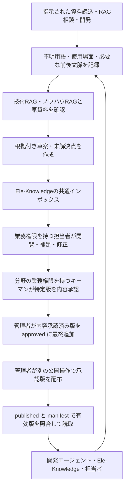

# 初期構想: 製品用語と基礎知識をAIと共有する

## 解決したい困りごと

当社製品の専門用語・略称・現場の通称は、AIが事前学習で知っていることを前提にできない。資料が検索できても、その用語が何を指すか、別の機種でも同じ意味か、取得した説明をどこまで使えるかを判断しにくい。

調査のたびに同じ説明をやり直すことを減らし、確認した知識を次の開発・相談へ引き継ぎたい。開発エージェントとEle-Knowledgeのエージェント・RAGが、共通の根拠付き知識を参照・加工できるようにする。

本書は方向性を共同確認する構想。2026-10-22のmonaの最新回答に基づき、開発中の正本はGit（monaブランチのknowledge/cards/）を維持し、運用開始時にS3へ切り替える。itai専用環境の検証実装は採用候補であり、二段階承認と切替手順への変更が必要。#195への取込は別途確認する。このPRは文書のみで、AWS変更・資料登録・KB取込・検索対象変更を行わない。

## 管理方針: ノウハウの一種として、一単元ずつ育てる

用語解説と、その意味を理解するための基礎知識を、ノウハウと共通のMarkdown・編集正本・承認・版管理・公開経路で管理する。既存の`case_summary` / `practice_guide`に加え、「用語・基礎知識」という分類を持たせる。分類の機械用識別子は詳細設計で決める。人も閲覧でき、若手担当者の学習・引継ぎにも利用できる知識とする。一単元は「ひとつの用語と、その仕組み・対象条件を理解できるまとまり」とし、必要に応じて単元同士を関連付ける。

例えば「BKという呼称」「ブレーキの状態と運転条件」「商品名・機種コード・制御方式の対応」などが候補になる。これは題材の例であり、用語の意味・仕様・操作を本書で確定するものではない。

| 単元に持たせたい情報 | 内容の例 |
| --- | --- |
| 用語と別名 | 正式名称、略称、通称、表記ゆれ、混同しやすい言葉 |
| 意味と仕組み | 何を指し、他の部品・信号・制御とどう関係するか |
| 対象条件 | 機種、制御方式、年代、版による違い、適用できない条件 |
| 根拠 | 原本の文書番号・版・ページ、技術者からの説明と確認日 |
| 確認状態 | AIの仮説、技術者説明、原本で確認できた事実、未確認事項 |
| 関連する知識 | 別単元、参照すべき資料、次に確認する点 |

同じ単元でも、主張ごとに確認状態が違うことを許容する。技術者の説明は出所付きで残し、AIの推測や原本照合済みの事実と区別する。AIが同じ説明を何度参照しても、それだけで確かさを上げない。

## 大まかな構成案

> 最終検証: 2026-10-22 — itai b9076cbdの実装契約・S3アダプター・SAMと#195実施報告を静的照合。今回のAWS・ブラウザ再試験は未実施。

### 不明点の収集と草案化

資料読み込みを明示的に指示されたとき、またはRAGチャット・開発中に用語理解や辞書の不足が確認できたとき、不明用語を候補として登録する。用語、使用場面、必要最小限の前後文脈、出典・版・該当箇所、何が不明かを残し、意味を推測で確定しない。単なる未検索と、検索したが見つからなかった状態を区別する。

候補に対し、許可された技術RAG・ノウハウRAGと原資料で後から根拠を調べ、解説のたたき台を作ってインボックスへ投函する。資料間の矛盾、機種・版の条件、未確認点、検索で見つからなかった点を残す。既存の同一用語・単元がある場合は新しい辞書を増やさず、既存単元への修正候補に関連付ける。AIの草案や過去の生成回答を、それ自体で独立した正解の根拠にしない。

文脈の保存・モデル入力・管理者への共有は元情報の許可範囲内とし、個人情報や秘匿情報、会話全文を無条件に収集しない。検索・生成の起動方式、費用上限、停止条件、未処理候補の重複抑制は詳細設計で決める。

### Ele-Knowledgeの共通インボックスと権限

> 最終検証: 2026-11-13 — itai専用契約とmonaの10/22回答（二段階承認）・11/5業務決定を照合。共有環境の権限設定は未実査。

ノウハウ・用語・基礎知識は共通インボックスで扱う。Cognito User Pool＋JWTによる本人確認の後、Lambdaで業務権限・分野・読者・期限を認可表と照合する。閲覧、編集、内容確認・承認、公開・停止、公開版の読取を分け、内容承認と、approvedへの最終追加・公開を別操作にして後者は管理者だけに許可する（monaの[10/22回答](https://github.com/yukiworkspace/EleKnowledge-AI/pull/200#issuecomment-6337510165)と[補足](https://github.com/yukiworkspace/EleKnowledge-AI/pull/200#issuecomment-6337807427)）。クライアント申告の役割やボタンの表示だけで許可せず、個人チャットの本人分離と元資料の権限を維持する。

2026-11-05の開発試行では、キーマンを置かず、内容確認・承認をmonaとitaiの2人で行い、読者もmona・itaiに限定する。社内全体への拡大とキーマンの任命は運用時に再判断する。既存のitai専用実装契約はadmin所属を必要条件にしていない。一方、共有環境の管理者識別はCognito `admin`グループ＋認可表の分野制約、停止はadmin全員とする案が暫定であり、実装契約の変更や共有環境への採用は未確認。先輩チャット等の既存admin制限を一括撤廃しない。

itaiの合成検証ではadminでない2つ目のアカウントが承認操作によりapprovedへ保存した記録がある。これは改訂前の実装であり、内容承認だけではapprovedへ保存できない二段階方式の受入証拠にはしない。

### S3正本と共有参照先

> 最終検証: 2026-11-13 — itai専用のS3契約とmonaの10/22回答・11/5移行決定を照合。AWS・実データは未実査。

ノウハウと用語・基礎知識はMarkdownを共通の形式とし、S3を正本とする。作業用バケットの `drafts/` は編集の場で、確認対象はVersionId＋sha256で固定する。内容承認は対象のVersionId＋sha256と判断者・日時に結び付け、正本への書込を伴わせない。管理者がその承認対象と同一の版を最終追加するときだけ、正本バケットの `approved/` へ本文と二段階の承認記録を不変コピーする。内容承認後に本文・根拠・対象条件を変えた版は再確認し、古い内容承認を流用しない。承認と公開は別操作で、公開中の本文とKB用metadataだけを `published/` に置き、`manifests/` で公開世代と有効版を管理する。

業務移行は2026-11-05から開始し、最初はブレーキ（BK）系の1単元を試行する。試行中の読者はmona・itaiに限定し、公開版は版ごとに無期限、草案は60日保持を暫定案とする。GitからS3への全カード移行はitaiが担当し、1単元の試行後、運用開始直前に行う。運用開始日は未定。Git側に承認記録がないため既存承認の引継ぎは行わず、試行単元は二段階承認を新規に実施する。これらは業務用の移行判断であり、itai専用環境での合成検証を会社共通の運用受入とは扱わない。

開発エージェントが直接書けるのは作業用だけ。内容承認・管理者の最終追加・公開・停止は責任別API/Lambdaを通し、正本への直接書込をバケットポリシーで制限する。両AIが知識として使うときは、公開manifest・本文hash・有効範囲を照合する共通読取経路を使う。未承認の作業版やapprovedの直接読取で代用しない。停止後は公開読取を拒否し、publishedを最新manifestに合わせて収束させる。

将来のBedrock KBのデータソースはpublishedだけを候補とし、drafts・approved・manifestsは投入しない。現在のitai検証ではKB作成・同期は未実施であり、metadataの準備や両AI向け読取契約の合成試験を、本番RAG接続・品質受入完了とは扱わない。

既存の[ノウハウ設計](design-2026-10-01-knowhow-flywheel.md)には今回の改訂を優先する節を追加した。独立した辞書の承認・保存システムは作らない。

## GitからS3への切替手順案

> 最終検証: 2026-10-23 — #200のmona最新回答とitai CLI契約の静的照合。以下は提案であり、移行・AWS操作は未実施。

1. **対象を固定する。** monaのGit SHA、対象カード一覧、ID・版・UTF-8本文のsha256、出典、現在の承認状態と公開範囲を移行台帳へ記録する。Gitに存在するカードを一括で承認済み・公開済みにはしない。対象・担当・読者・保持・除外理由は共同確認し、Gitの元カードを保持する。
2. **書込先と権限を確認する。** 作業用S3、認可表、API、管理者識別と二段階承認が受入済みであることを確認する。実データの投入許可が出るまでは合成カードだけで行う。全カードの移行中もGitを正本とし、切替直前は編集を止めるか追加変更を差分台帳に記録する。
3. **少数単元で試す。** 固定した本文を作業用draftsへ配置し、返されたVersionIdとhashを指定してCLIのregisterで作業版登録、確認依頼を行う。現行CLIに一括移行・dry-runがあるとは扱わない。まず単元ごとの成功・失敗・再試行を記録する。registerだけではapproved保存や公開はしない。
4. **二段階で確認する。** キーマンが固定版の内容を確認して承認し、管理者が同じ版をapprovedへ最終追加する。既存Gitの承認記録を引き継げる条件は別途確認し、自動承認しない。公開は管理者が対象単元を選び、別操作で行う。
5. **照合してから範囲を広げる。** Gitの固定一覧、S3作業版、approved、台帳のID・版・hash・根拠・読者を一対一で照合する。重複ID、文字コード・改行差、欠落、権限差、失敗行は停止して解消する。一括化はこの結果を受け、明示的な対象一覧・dry-run・再開位置・冪等性を備えた後続CLIとして設計する。
6. **切替を記録する。** 追加変更も照合したうえで、責任者・確認者・日時・対象範囲・正本の所在を記録する。両AIの読取は公開manifestとhash検証経由へ切り替え、未公開・停止済みの版が返らないことを確認する。KBを利用する場合の作成・同期・読取検証は別作業とする。
7. **中断・戻しを分ける。** 切替前に問題があればGit正本のまま中断する。切替後にS3だけで編集した内容がある場合は古いGitへ単純に戻さず、更新差分と公開状態を照合して戻し方を合意する。元カード・S3版・承認記録は移行の都合で削除しない。

## AIからどう使いたいか

- **開発エージェント**: 仕様や実装で意味が曖昧な用語に出会ったら単元を読み、必要な技術RAG・原本へ戻って確認する。推測で用語の対応や仕様をコードへ固定しない。
- **Ele-Knowledgeのエージェント・RAG**: 通称の理解、検索語の展開、機種条件の確認、利用者への用語説明に使う。正式な仕様・基準・法令・操作の判断では、対応する正式資料を確認する。
- **知識の改善**: 見つからなかった用語、原本との矛盾、技術者の訂正を草案へ戻す。AIによる加工結果は確認対象とし、既存の確認済み本文を無条件に上書きしない。

これは参照する知識を蓄積する構想であり、モデルの再学習や自動的な正解獲得を前提にしない。S3保存に加え、各エージェントから必要な単元を探して読む経路を設ける。

## 小さく始める案

> 最終検証: 2026-11-11 — monaの11/5決定を照合。BK単元の実データ・範囲・根拠資料は未確認。

まず、monaが指定したブレーキ（BK）系の一単元で試行する。開発中はキーマンを置かず、mona・itaiの二人で新規の二段階承認を行う。対象単元の具体的な範囲・ID・根拠資料と、BKを選んだ理由はコメントで特定されていないため、実データを登録する前に確認する。公開版は版ごと無期限、草案は60日保持を暫定案とし、読者はmona・itaiだけに限定する。

その単元を開発エージェントとEle-Knowledgeの両方から参照し、用語の混同を減らせるか、必要な原本へ到達できるか、未確認事項を断定しないかを確かめる。文書や検索ヒットが増えただけでは改善と判定しない。原本改訂時の見直しも少数の単元で試す。

## 設計の次セッションへの入口

必要な論点・対象文書・コード・リソースの棚卸しと再開プロンプトは、[統合設計の引継ぎ](features/development/product-domain-knowledge-integration-handoff.md)を参照する。#195への統合先はmonaが2026-10-22にYes。itai側の実装・配備記録と#195への採用・統合・マージは区別し、現行の設計・検証境界は同資料から確認する。

## 詳細設計で決めること

> 最終検証: 2026-11-11 — monaの11/5決定と残る確認条件を整理。共有環境・保持処理は未実査。

- BK系試行単元の具体的な範囲・ID・根拠資料・選定理由。担当: mona・itai。確認期限: 実データ登録前。未確認なら登録を止め、他単元へ拡大しない。
- 草案60日保持・公開版無期限の実装方法、削除・復旧条件。担当: itai案作成、mona確認。期限: 実データ登録前。合意までは合成データに限定する。
- 管理者をCognito `admin`＋認可表の分野制約で識別し、admin全員に停止を許可する暫定案の確認。担当: mona。期限: 共有環境へ採用する前。未確認なら共有環境へ適用せず、停止経路の受入も保留する。
- itai実装契約を二段階方式（内容承認だけではapprovedへ書けず、管理者の最終追加だけが書ける）へ改修する範囲と受入条件。担当: itai。期限: 共有環境へ採用する前。
- 原本改訂・説明の訂正・単元の廃止を検知し、影響する単元と利用先へ反映する方法。
- 実データの利用許可、二段階承認の具体的な担当割当、エージェントの候補登録経路。
- 既存KBやノウハウ検索とのつなぎ方、参照を始める条件、検索や生成の費用・停止条件。
- 品質の評価方法、運用負担、構築・保管・検索の費用。

閲覧範囲は元資料の権限・機密区分を踏まえて決め、エージェント経由でも広げない。未確認の草案を一般向け回答の確定根拠にしない。実際に資料・機種・利用者等を追加／除外するときは、プロジェクトの共同確認と決定記録を行う。既存資料の削除はこの構想に含めない。

## 方向性と改訂の確認記録

> 最終検証: 2026-11-13 — #200のmona回答（10/22の二段階承認を含む）・11/5決定とitai実装記録を照合。実環境の追加検証は未実施。

- 2026-10-21: monaが共通Markdown・ノウハウ共通管理・少数単元の試行に[Yes](https://github.com/yukiworkspace/EleKnowledge-AI/pull/200#issuecomment-6318438772)。当時のGit正本・admin閲覧案は開始時点の案。
- 2026-10-22: monaが実装の統合先を#195とする方針に[Yes](https://github.com/yukiworkspace/EleKnowledge-AI/pull/200#issuecomment-6328353993)。マージ・AWS変更・KB取込の許可とは分ける。
- 同日: itaiの実装・配備報告を受け、ユーザーが#200をその実装へ寄せるよう指定。Git正本案をS3正本へ、admin所属条件を認可表による業務権限へ改訂した。当日時点でmonaとの共有方針・実業務への割当は未完了だったが、11/5の決定記録で更新する。
- 同日18:32・18:48 JST: monaの[回答](https://github.com/yukiworkspace/EleKnowledge-AI/pull/200#issuecomment-6337510165)と[補足](https://github.com/yukiworkspace/EleKnowledge-AI/pull/200#issuecomment-6337807427)で、開発中Git正本／運用開始時S3切替、キーマンの内容承認／管理者のapproved保存・公開という二段階へ修正。後の補足を優先し、キーマンを確認依頼だけに制限する案は採用しない（その後11/5の決定で、開発中はキーマンを置かずmona・itaiが内容承認する）。マージ可は未取得。
- 2026-10-23: 最新回答に文書を整合し、移行手順案を追加。二段階承認のコード変更・移行・AWS実査は未実施。

### 2026-11-05: 開発試行の業務判断

> 最終検証: 2026-11-05 — monaの[試行・権限・保持・統合範囲の決定](https://github.com/yukiworkspace/EleKnowledge-AI/pull/200#issuecomment-6659183974)と[キーマン・開始時期の決定](https://github.com/yukiworkspace/EleKnowledge-AI/pull/200#issuecomment-6659267192)を照合。AWS実査・実データ登録は未実施。

- 決定者・日付: mona、2026-11-05。最初の試行対象はブレーキ（BK）系1単元。開発中の内容確認・承認者と読者はmona・itaiのみ。キーマンは置かず、必要になった時点で再判断する。
- 試行開始: 2026-11-05から進めてよい。GitからS3への移行責任者はitai。1単元の試行後、運用開始直前に全カードを移行する。全体の運用開始日は未定。
- 保持: 公開版は版ごと無期限、草案は60日を暫定案とする。Git側に承認記録がないため既存承認は移行せず、試行単元を新規に二段階承認する。
- 対象・影響: 試行に含めるのはBK系1単元。読者はmona・itai。社内全体への拡大は含めない。他のカードはGitに保持し、移行時まで削除・公開しない。既存カードの実数・対象IDは未確認。
- 暫定事項: 管理者識別はCognito `admin`グループ＋認可表の分野制約、停止権限はadmin全員。確認責任者はmona、期限は共有環境へ採用する前。確認できない場合は共有環境へ適用せず、停止操作を含む運用受入を保留する。
- 選定根拠: monaの決定コメントはBK系を指定しているが、選定理由・対象ID・根拠資料を示していない。実データ登録前にmona・itaiで特定し、特定できなければ登録を開始しない。
- #195との分離: 共通知識（二段階承認等）は#195へ含めず、文書・実装とも別PRで扱う。この#200は方針・決定記録の共同確認PRであり、AWS変更、KB取込、実データ登録、共有環境への適用は含まない。

## 残る共同確認

> 最終検証: 2026-11-11 — 決定済み事項・暫定事項・実データ登録前の確認条件を#200コメントと照合。

2026-11-05の決定で、試行単元の大分類、試行中の読者・承認者、保持の暫定値、#195との分離は記録済み。上記の暫定事項と試行単元の具体的な境界・根拠資料は、指定された確認期限までに確定する。未確定のまま業務データを登録したり、読者を拡大したりしない。本書の共同確認・マージ可と、共有devへの反映、AWS変更・KB同期・有料実測の実行許可は別に扱う。

## 参考

- [既存の知識循環・管理設計案](design-2026-10-01-knowhow-flywheel.md): 出典付きMarkdownと確認・版管理の関係を引き継ぐ。
- [Amazon Bedrock: S3データソース](https://docs.aws.amazon.com/bedrock/latest/userguide/s3-data-source-connector.html): 文書とメタデータをつなぐ方式の参考。既存環境への適合は詳細設計で確認する。
- [Amazon S3 Versioning](https://docs.aws.amazon.com/AmazonS3/latest/userguide/Versioning.html): オブジェクトの版保存の参考。技術的な承認状態は別に管理する。
