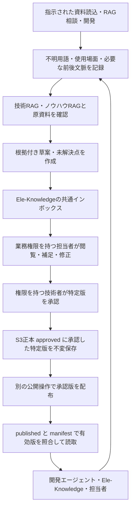

# 初期構想: 製品用語と基礎知識をAIと共有する

## 解決したい困りごと

当社製品の専門用語・略称・現場の通称は、AIが事前学習で知っていることを前提にできない。資料が検索できても、その用語が何を指すか、別の機種でも同じ意味か、取得した説明をどこまで使えるかを判断しにくい。

調査のたびに同じ説明をやり直すことを減らし、確認した知識を次の開発・相談へ引き継ぎたい。開発エージェントとEle-Knowledgeのエージェント・RAGが、共通の根拠付き知識を参照・加工できるようにする。

本書は方向性を共同確認する構想。2026-10-22のユーザー指定により、#195で共有されたitai側の実装（S3正本・業務権限）へ整合する。実装・配備先はitaiブランチであり、#195自体への取込は別途確認する。このPRは文書のみで、AWS変更・資料登録・KB取込・検索対象変更を行わない。

## 管理方針: ノウハウの一種として、一単元ずつ育てる

用語解説と、その意味を理解するための基礎知識を、ノウハウと共通のMarkdown・編集正本・承認・版管理・公開経路で管理する。既存の`case_summary` / `practice_guide`に加え、「用語・基礎知識」という分類を持たせる。分類の機械用識別子は詳細設計で決める。人も閲覧でき、若手担当者の学習・引継ぎにも利用できる知識とする。一単元は「ひとつの用語と、その仕組み・対象条件を理解できるまとまり」とし、必要に応じて単元同士を関連付ける。

例えば「BKという呼称」「ブレーキの状態と運転条件」「商品名・機種コード・制御方式の対応」などが候補になる。これは題材の例であり、用語の意味・仕様・操作を本書で確定するものではない。

| 単元に持たせたい情報 | 内容の例 |
| --- | --- |
| 用語と別名 | 正式名称、略称、通称、表記ゆれ、混同しやすい言葉 |
| 意味と仕組み | 何を指し、他の部品・信号・制御とどう関係するか |
| 対象条件 | 機種、制御方式、年代、版による違い、適用できない条件 |
| 根拠 | 原本の文書番号・版・ページ、技術者からの説明と確認日 |
| 確認状態 | AIの仮説、技術者説明、原本で確認できた事実、未確認事項 |
| 関連する知識 | 別単元、参照すべき資料、次に確認する点 |

同じ単元でも、主張ごとに確認状態が違うことを許容する。技術者の説明は出所付きで残し、AIの推測や原本照合済みの事実と区別する。AIが同じ説明を何度参照しても、それだけで確かさを上げない。

## 大まかな構成案

> 最終検証: 2026-10-22 — itai b9076cbdの実装契約・S3アダプター・SAMと#195実施報告を静的照合。今回のAWS・ブラウザ再試験は未実施。

### 不明点の収集と草案化

資料読み込みを明示的に指示されたとき、またはRAGチャット・開発中に用語理解や辞書の不足が確認できたとき、不明用語を候補として登録する。用語、使用場面、必要最小限の前後文脈、出典・版・該当箇所、何が不明かを残し、意味を推測で確定しない。単なる未検索と、検索したが見つからなかった状態を区別する。

候補に対し、許可された技術RAG・ノウハウRAGと原資料で後から根拠を調べ、解説のたたき台を作ってインボックスへ投函する。資料間の矛盾、機種・版の条件、未確認点、検索で見つからなかった点を残す。既存の同一用語・単元がある場合は新しい辞書を増やさず、既存単元への修正候補に関連付ける。AIの草案や過去の生成回答を、それ自体で独立した正解の根拠にしない。

文脈の保存・モデル入力・管理者への共有は元情報の許可範囲内とし、個人情報や秘匿情報、会話全文を無条件に収集しない。検索・生成の起動方式、費用上限、停止条件、未処理候補の重複抑制は詳細設計で決める。

### Ele-Knowledgeの共通インボックスと権限

> 最終検証: 2026-10-22 — itai実装の認可表・API・S3正本契約を照合。

ノウハウ・用語・基礎知識は共通インボックスで扱う。Cognito User Pool＋JWTによる本人確認の後、Lambdaで業務権限・分野・読者・期限を認可表と照合する。admin所属は必要条件にせず、adminだけでも編集・承認・公開を許可しない。閲覧、編集、技術承認、公開・停止、公開版の読取を分け、個人チャットの本人分離と元資料の権限を維持する。

itaiの合成検証ではadminでない2つ目のアカウントによる承認を確認した記録がある。共有Cognitoグループは変更していない。先輩チャット等の既存admin制限を一括撤廃する方針ではない。実業務の役割・担当・読者・保持方針は共同確認を残す。

### S3正本と共有参照先

> 最終検証: 2026-10-22 — itaiのS3正本化・公開停止・読取契約を照合。

ノウハウと用語・基礎知識はMarkdownを共通の形式とし、Gitを正本にする案をS3へ改訂する。作業用バケットの `drafts/` は編集の場で、確認対象はVersionId＋sha256で固定する。承認時に正本バケットの `approved/` へその特定版と承認記録を不変コピーする。承認と公開は別操作で、公開中の本文とKB用metadataだけを `published/` に置き、`manifests/` で公開世代と有効版を管理する。

開発エージェントが直接書けるのは作業用だけ。承認・公開・停止は責任別API/Lambdaを通し、正本への直接書込をバケットポリシーで制限する。両AIが知識として使うときは、公開manifest・本文hash・有効範囲を照合する共通読取経路を使う。未承認の作業版やapprovedの直接読取で代用しない。停止後は公開読取を拒否し、publishedを最新manifestに合わせて収束させる。

将来のBedrock KBのデータソースはpublishedだけを候補とし、drafts・approved・manifestsは投入しない。現在のitai検証ではKB作成・同期は未実施であり、metadataの準備や両AI向け読取契約の合成試験を、本番RAG接続・品質受入完了とは扱わない。

既存の[ノウハウ設計](design-2026-10-01-knowhow-flywheel.md)には今回の改訂を優先する節を追加した。独立した辞書の承認・保存システムは作らない。

## AIからどう使いたいか

- **開発エージェント**: 仕様や実装で意味が曖昧な用語に出会ったら単元を読み、必要な技術RAG・原本へ戻って確認する。推測で用語の対応や仕様をコードへ固定しない。
- **Ele-Knowledgeのエージェント・RAG**: 通称の理解、検索語の展開、機種条件の確認、利用者への用語説明に使う。正式な仕様・基準・法令・操作の判断では、対応する正式資料を確認する。
- **知識の改善**: 見つからなかった用語、原本との矛盾、技術者の訂正を草案へ戻す。AIによる加工結果は確認対象とし、既存の確認済み本文を無条件に上書きしない。

これは参照する知識を蓄積する構想であり、モデルの再学習や自動的な正解獲得を前提にしない。S3保存に加え、各エージェントから必要な単元を探して読む経路を設ける。

## 小さく始める案

まず、意味の確認に困った一単元を草案にし、技術者が「説明・対象条件・根拠・不明点」を確認する。BK等は候補だが、試行テーマと担当者は共同確認で決める。

その単元を開発エージェントとEle-Knowledgeの両方から参照し、用語の混同を減らせるか、必要な原本へ到達できるか、未確認事項を断定しないかを確かめる。文書や検索ヒットが増えただけでは改善と判定しない。原本改訂時の見直しも少数の単元で試す。

## 設計の次セッションへの入口

必要な論点・対象文書・コード・リソースの棚卸しと再開プロンプトは、[統合設計の引継ぎ](features/development/product-domain-knowledge-integration-handoff.md)を参照する。#195への統合先はmonaが2026-10-22にYes。itai側の実装・配備記録と#195への採用・統合・マージは区別し、現行の設計・検証境界は同資料から確認する。

## 詳細設計で決めること

- 最初の対象単元、内容を確認する担当者、参照できる利用者・エージェントの範囲。
- S3正本・VersionId＋hash・公開manifest契約の共有環境への採用と実データの保持方針。
- 原本改訂・説明の訂正・単元の廃止を検知し、影響する単元と利用先へ反映する方法。
- 業務権限と分野・読者・期限の割当、原資料の利用許可、エージェントの候補登録経路。
- 既存KBやノウハウ検索とのつなぎ方、参照を始める条件、検索や生成の費用・停止条件。
- 品質の評価方法、運用負担、構築・保管・検索の費用。

閲覧範囲は元資料の権限・機密区分を踏まえて決め、エージェント経由でも広げない。未確認の草案を一般向け回答の確定根拠にしない。実際に資料・機種・利用者等を追加／除外するときは、プロジェクトの共同確認と決定記録を行う。既存資料の削除はこの構想に含めない。

## 方向性と改訂の確認記録

> 最終検証: 2026-10-22 — #200のmona回答、本ユーザー依頼、itai実装・実施記録を照合。

- 2026-10-21: monaが共通Markdown・ノウハウ共通管理・少数単元の試行に[Yes](https://github.com/yukiworkspace/EleKnowledge-AI/pull/200#issuecomment-6318438772)。当時のGit正本・admin閲覧案は開始時点の案。
- 2026-10-22: monaが実装の統合先を#195とする方針に[Yes](https://github.com/yukiworkspace/EleKnowledge-AI/pull/200#issuecomment-6328353993)。マージ・AWS変更・KB取込の許可とは分ける。
- 同日: itaiの実装・配備報告を受け、ユーザーが#200をその実装へ寄せるよう指定。Git正本案をS3正本へ、admin所属条件を認可表による業務権限へ改訂する。monaとの共有方針としての確認・実業務への割当は未完了。

## この段階で共同確認したいこと

1. 用語・基礎知識をノウハウ共通管理し、S3作業用／正本、特定版承認、別操作公開・停止を共通基盤としてよいか。
2. admin所属条件に代えて、業務権限・分野・読者・期限で閲覧・編集・承認・公開を認可する方針でよいか。
3. itai検証結果を共有方針に採用する際の実単元・担当・読者・保持・#195への統合範囲をどう定めるか。

本書の共同確認とマージ可、共有devへの反映、AWS変更・KB同期・有料実測の実行許可は分ける。

## 参考

- [既存の知識循環・管理設計案](design-2026-10-01-knowhow-flywheel.md): 出典付きMarkdownと確認・版管理の関係を引き継ぐ。
- [Amazon Bedrock: S3データソース](https://docs.aws.amazon.com/bedrock/latest/userguide/s3-data-source-connector.html): 文書とメタデータをつなぐ方式の参考。既存環境への適合は詳細設計で確認する。
- [Amazon S3 Versioning](https://docs.aws.amazon.com/AmazonS3/latest/userguide/Versioning.html): オブジェクトの版保存の参考。技術的な承認状態は別に管理する。
