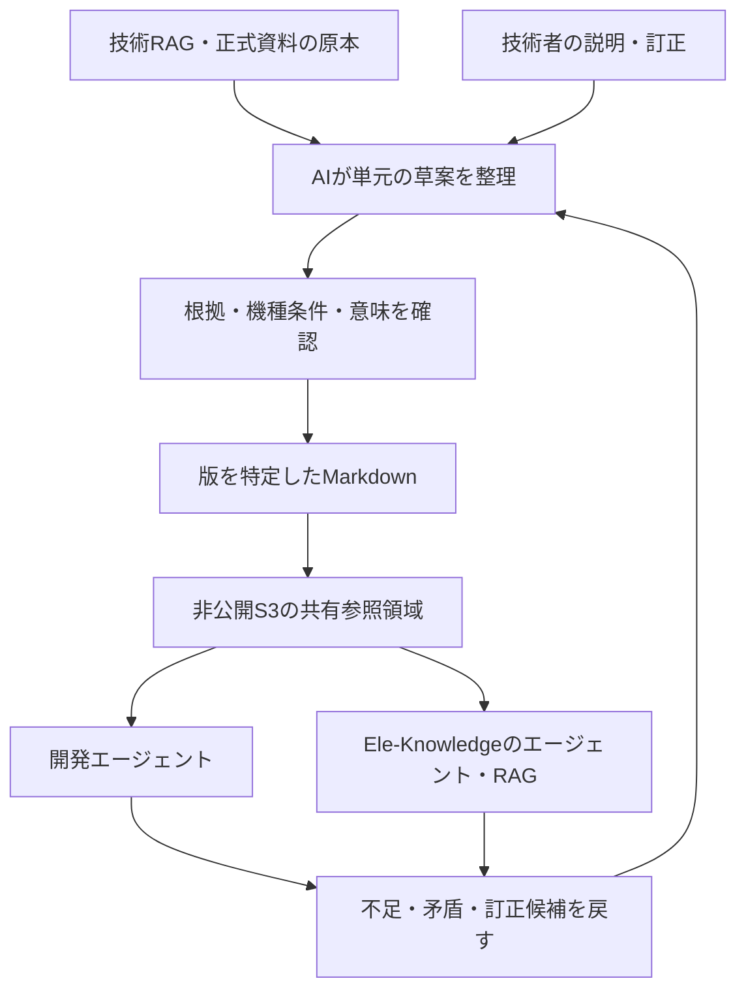

# 初期構想: 製品用語と基礎知識をAIと共有する

## 解決したい困りごと

当社製品の専門用語・略称・現場の通称は、AIが事前学習で知っていることを前提にできない。資料が検索できても、その用語が何を指すか、別の機種でも同じ意味か、取得した説明をどこまで使えるかを判断しにくい。

調査のたびに同じ説明をやり直すことを減らし、確認した知識を次の開発・相談へ引き継ぎたい。開発エージェントとEle-Knowledgeのエージェント・RAGが、共通の根拠付き知識を参照・加工できるようにする。

本書は方向性を共同確認する初期構想。データ構造・バケット構成・実装方式は未確定であり、このPRではAWSリソース作成、資料登録、KB取込、検索対象の変更を行わない。

## 方針案: 一単元ずつ、根拠付きで育てる

用語解説と、その意味を理解するための基礎知識をMarkdownにまとめる。一単元は「ひとつの用語と、その仕組み・対象条件を理解できるまとまり」とし、必要に応じて単元同士を関連付ける。

例えば「BKという呼称」「ブレーキの状態と運転条件」「商品名・機種コード・制御方式の対応」などが候補になる。これは題材の例であり、用語の意味・仕様・操作を本書で確定するものではない。

| 単元に持たせたい情報 | 内容の例 |
| --- | --- |
| 用語と別名 | 正式名称、略称、通称、表記ゆれ、混同しやすい言葉 |
| 意味と仕組み | 何を指し、他の部品・信号・制御とどう関係するか |
| 対象条件 | 機種、制御方式、年代、版による違い、適用できない条件 |
| 根拠 | 原本の文書番号・版・ページ、技術者からの説明と確認日 |
| 確認状態 | AIの仮説、技術者説明、原本で確認できた事実、未確認事項 |
| 関連する知識 | 別単元、参照すべき資料、次に確認する点 |

同じ単元でも、主張ごとに確認状態が違うことを許容する。技術者の説明は出所付きで残し、AIの推測や原本照合済みの事実と区別する。AIが同じ説明を何度参照しても、それだけで確かさを上げない。

## 大まかな構成案

S3を、確認した知識を保存・配布する共有参照先とする。人が読むMarkdownに、検索・機械処理に使うメタデータを添える案とする。用語・単元ID・対象機種・版・確認状態・出典などを参照に使いたいが、具体的なスキーマは詳細設計で決める。

編集履歴・差分確認には非公開Git等を使い、確認した版をS3へ反映する構成を候補とする。S3で編集まで管理する方式も比較し、本文の正本を二重にしない。新規バケットか既存領域の分離か、単元単位のファイル配置、KB接続方式は未決とする。

既存の[出典付き業務知識の設計案](design-2026-10-01-knowhow-flywheel.md)にあるMarkdown・根拠・確認・版管理の考え方を活かし、事例ノウハウを読む前提となる「用語と基礎知識」を補う。独立した承認・保存の仕組みを重複して作ることは避ける。

## AIからどう使いたいか

- **開発エージェント**: 仕様や実装で意味が曖昧な用語に出会ったら単元を読み、必要な技術RAG・原本へ戻って確認する。推測で用語の対応や仕様をコードへ固定しない。
- **Ele-Knowledgeのエージェント・RAG**: 通称の理解、検索語の展開、機種条件の確認、利用者への用語説明に使う。正式な仕様・基準・法令・操作の判断では、対応する正式資料を確認する。
- **知識の改善**: 見つからなかった用語、原本との矛盾、技術者の訂正を草案へ戻す。AIによる加工結果は確認対象とし、既存の確認済み本文を無条件に上書きしない。

これは参照する知識を蓄積する構想であり、モデルの再学習や自動的な正解獲得を前提にしない。S3保存に加え、各エージェントから必要な単元を探して読む経路を設ける。

## 小さく始める案

まず、意味の確認に困った一単元を草案にし、技術者が「説明・対象条件・根拠・不明点」を確認する。BK等は候補だが、試行テーマと担当者は共同確認で決める。

その単元を開発エージェントとEle-Knowledgeの両方から参照し、用語の混同を減らせるか、必要な原本へ到達できるか、未確認事項を断定しないかを確かめる。文書や検索ヒットが増えただけでは改善と判定しない。原本改訂時の見直しも少数の単元で試す。

## 詳細設計で決めること

- 最初の対象単元、内容を確認する担当者、参照できる利用者・エージェントの範囲。
- Markdownの編集正本、S3の役割、下書きと確認済み版の扱い、公開する版の特定方法。
- 原本改訂・説明の訂正・単元の廃止を検知し、影響する単元と利用先へ反映する方法。
- 認証・認可、機密区分、暗号化、ログに残す内容、閲覧・加工・公開の権限。
- 既存KBやノウハウ検索とのつなぎ方、参照を始める条件、検索や生成の費用・停止条件。
- 品質の評価方法、運用負担、構築・保管・検索の費用。

閲覧範囲は元資料の権限・機密区分を踏まえて決め、エージェント経由でも広げない。未確認の草案を一般向け回答の確定根拠にしない。実際に資料・機種・利用者等を追加／除外するときは、プロジェクトの共同確認と決定記録を行う。既存資料の削除はこの構想に含めない。

## この段階で共同確認したいこと

1. 会社固有の用語・基礎知識を、一単元ずつ根拠付きでまとめ、両方のエージェントで共有する方向で検討を進めてよいか。
2. S3を共有参照先の候補とし、AIの草案作成と技術者の内容確認を組み合わせて、小さな試行から具体化してよいか。

本書の合意は方向性の合意であり、AWS作成、KB取込、対象範囲の拡大、費用発生を伴う試験の実行承認とは分ける。

## 参考

- [既存の知識循環・管理設計案](design-2026-10-01-knowhow-flywheel.md): 出典付きMarkdownと確認・版管理の関係を引き継ぐ。
- [Amazon Bedrock: S3データソース](https://docs.aws.amazon.com/bedrock/latest/userguide/s3-data-source-connector.html): 文書とメタデータをつなぐ方式の参考。既存環境への適合は詳細設計で確認する。
- [Amazon S3 Versioning](https://docs.aws.amazon.com/AmazonS3/latest/userguide/Versioning.html): オブジェクトの版保存の参考。技術的な承認状態は別に管理する。
