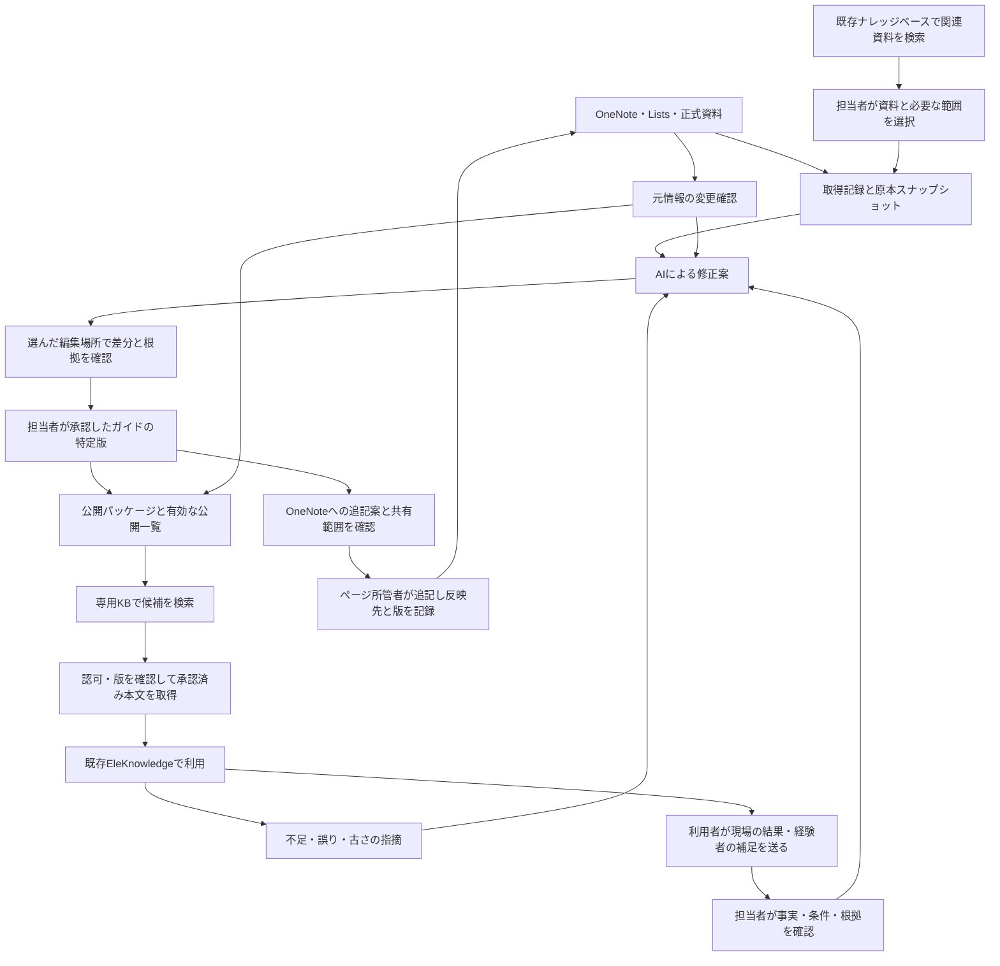

# 設計案: OneNote・Lists・既存ナレッジベースから育てる、出典付きの業務知識

> 共同確認用ドラフト。実装・デプロイ・検索対象の追加を承認する文書ではない。
> 2026-10-16に、会話の前提、ローカルコード、Microsoft / AWSの公式仕様と設計の整合を確認した。
> 実際のOneNote、Lists、エクスポート、生成済みMarkdown、Microsoft 365テナント、AWS環境は未実査。
> 過去の[調査](./survey-2026-10-01-knowhow-flywheel.md)は背景資料。[PR #191](https://github.com/yukiworkspace/EleKnowledge-AI/pull/191)の構想を具体化する共同確認用の設計案であり、合意済み仕様ではない。
> 2026-10-19の目的・全体像・改善提案・段階導入の総括は[工技先輩と知識循環の構想](./concept-2026-10-19-kougi-senpai-knowledge-cycle.md)を参照。本書は技術契約の詳細を扱う。

## 0. 推奨する構成

**Listsの不具合・原因・対策、OneNoteの業務上の注意点、既存ナレッジベース内の関連資料を生成AIで関連付け、Obsidianで扱うMarkdownをチームのknow-how本文にする。担当者はWeb画面で資料の検索・選択、根拠確認・AI編集・差分確認・承認を行えるようにする。**

目的は既存情報の整理だけでなく、相談・現場での結果・担当者の補足から新しいノウハウを収集する循環を作ること。収集した候補を確認してMarkdownへ反映し、そのうち広く知らせる価値と共有許可がある内容をOneNoteへの追記案として還元する。Markdownをノウハウの編集正本に保ち、OneNoteは原記録と日常の共有先として使う。収集と還元は§14.6–14.7に示す。

OneNote / Listsは元の業務記録を更新する場所、Markdownは根拠を体系化したノウハウの編集正本、ObsidianとWeb画面はその編集・閲覧環境とする。Markdownは原記録からの派生知識であると同時に、整理・確認したノウハウを育てる管理元になる。正式な仕様・基準・法令は、所管する正式文書を優先する。全社員にObsidianやGitの操作を求めない。

利用者側には「工技先輩エージェント」を置く。質問に関連する公開済みMarkdownを読み、そこに整理した条件・確認順・出典を手がかりに、本人が閲覧できる既存KBの資料から必要な情報を追加で探す。Lists / OneNoteの原記録へは認証付きの出典リンクで案内し、取込用スナップショットを一般利用者向けの検索対象にしない。Markdownの読取だけで回答を完結させる必要はなく、根拠不足や条件違いを見つけたら検索・利用者への確認・所管への照会案へ進む。動きの契約は§9.1に示す。

最初は既存Markdownの少数テーマを取り込み、Web画面で出典を確認し、AIによる節単位の修正案を人が採用・修正できる流れを作る。3テーマは開始規模の例でありノルマではない。検索への公開は編集とは別に検証し、最初から全Vaultを公開しない。管理者への連携相談は並行できるが、Graph連携を最初の試行の前提にはしない。

共有Markdownの保存先は一つにする。推奨は会社が認める非公開Gitで版管理し、Web画面の認証済みバックエンドに書込経路をまとめる構成。Obsidianも同じMarkdownを開けるが、ローカル変更は基準版付きの修正案として同じ保存・確認経路へ戻す。M365へノウハウ本文の管理を戻す案は採らない。担当者画面は§15、運用は§14に示す。

| 判断 | 推奨 | 理由 |
|---|---|---|
| 元情報の管理 | OneNote・Listsの既存運用を継続 | 個別記録と正式文書の更新責任を保つ |
| 既存ナレッジベースの利用 | 関連資料を検索し、担当者が根拠として選択 | 既存資料を再利用し、検索結果から原資料の版・条件を確認する |
| 知識の単位 | テーマ別Markdown。比較、重要な注意点、教育・引継ぎも対象 | 頻度だけで価値を限定せず、条件・例外を読み切れる単位にする |
| 編集 | 同じMarkdownをObsidian / Web画面で扱い、正本への反映はバックエンドで統一 | 二つの版の自由な上書き同期を防ぎ、担当者にGit操作を求めない |
| AIの役割 | 関連付け、整理、不足・矛盾の候補、修正差分 | 根拠のない補完や自動上書きを防ぐ |
| 新しい知見の収集 | 現場の結果・経験者の補足を、本人が送る候補として受け付ける | 検索だけでは得られない知見を、条件・確認者付きで残す |
| OneNoteへの還元 | 確認済みMarkdownから追記案を作り、担当者が確認・編集・コピーして手動で追加 | 普段OneNoteを見る人にも成果を届け、自動書込を前提にしない |
| 初期の取得 | 今の手動取得 + 小さな取込記録 | 取得方式を変えず価値を試せる |
| 社員の入口 | 既存EleKnowledgeの検索・チャット | 利用者に新しい知識管理ツールの操作を求めない |
| 利用時の探索 | 工技先輩エージェントがMarkdownを確認し、足りない根拠を許可された資料から検索 | 整理した知識を、実際の質問に合う情報への案内にも使う |
| 共有 | 確認したMarkdownの特定版。最初は単一の限定読者グループ | 編集中の版と、利用者へ届ける版を分ける |
| 検索用保存 | 検索経由の共有が必要と確認できた場合だけ、専用S3 + 別のBedrock Knowledge Base | 直接参照や既存共有で足りる間は追加せず、採用時も共有KBへの書込・Syncを避ける |
| 更新・撤回 | 公開一覧から先に無効化し、その後に検索索引を更新 | 古い検索結果が残っても利用を止める |

## 1. 今回の前提と、検証する価値

会話から確認した運用:

- 業務の多くをOneNoteに記録している。
- Microsoft Listsには、不具合の内容・原因・対策まで記録している。
- これらをローカルに取得し、生成AIで体系化してObsidianのMarkdownに整理している。
- そこでできたMarkdownを、チームで使うknow-howの土台として育てたい。
- 担当者がフロントエンドで内容・元情報を確認し、AIを用いてMarkdownを編集することを希望している。
- 既存ナレッジベースの関連資料も取り込み、Lists・OneNoteと合わせてノウハウ作成・更新に使いたい。
- 「工技先輩エージェント」がMarkdownを確認しながら、質問に必要な情報を探しに行く形にしたい。
- ノウハウを収集してMarkdownを継続的に強化し、みんなが見るOneNoteにも追記できる情報を集めたい。

検証する仮説は、**複数の事例・業務記録を横断して条件の違いを示すことで、判断準備の時間と問い合わせの往復を減らせること**。Markdownの件数や生成量を成功指標にしない。

直接OneNote / Listsを探した方が早いテーマは、そのまま直接参照する。内容を増やすための体系化は行わない。

## 2. 4つの層と責任



| 層 | 内容 | 更新責任・公開 |
|---|---|---|
| 元情報 | OneNote、Lists、既存ナレッジベース内の資料、リンク先の正式資料 | 各所管。承認済み知見のOneNote追記は§14.7の別操作とし、AIの独断で変更しない |
| 取得記録 | 原本1ページ / 1項目単位の取得物、正規化データ、添付一覧 | 取込担当。制限された作業領域。社員向け検索には載せない |
| 整理した知識 | 出典付きの事例比較・業務ガイド・確認済み知見 | 知識編集担当と分野の承認者。未承認版は編集者だけが扱う |
| 公開用データ | 承認した特定版から生成した閲覧本文と検索用データ | 公開担当。公開一覧で有効な版だけを利用する |

この4層はデータの責任を区別するためのもので、4つの手作業台帳や専任者を置く意味ではない。個人の編集試行では原本と下書きの対応だけを小さく記録し、承認・公開の台帳は共有へ進む時に機械化する。

「原本」という語は、記録元の意味と正式基準の意味を区別する。Listsの対策記録やOneNoteのメモが、存在するだけで正式な施工手順になるわけではない。

## 3. Markdownで整理する内容

種類は、最初は次の2つに絞る。

- `case_summary`: 個別事例または複数事例の整理。症状・原因・対策は出典の記録として示す。
- `practice_guide`: 業務の確認順、条件の違い、例外、照会先を整理した判断支援。一般化した知見には所管者の確認を付ける。

原文への索引や出典付きの要点整理も含める。「暗黙知だけ」に限定しない。正式文書の解釈や変更をMarkdownだけで確定しない。

本文の基本形:

```markdown
# テーマ名
## 使う場面・対象条件
## 最初に確認すること
## 関連する事例と、その違い
| 事例 | 条件 | 記録された原因・対策 | 今回への適用が未確認の点 | 出典 |
## 確認済みの判断ポイント
## 適用外・担当者に確認する場面
## 正式資料・元情報
## 未確認事項
```

実務上の数値、対策、対象機種、例外条件には、その記述を支える原本の列・見出しまで示す。導入文まで細かく分解しない。経験者が新たに補った知見は、誰が、どの範囲を確認したかを根拠にする。

個別事例の対策を共通の標準手順へ格上げする場合は、通常の文章修正と区別して所管判断へ戻す。AIは記録にない内容を未確認のまま残す。

## 4. 最小のデータ契約

### 4.1 元情報の識別

> 最終検証: 2026-10-19 — 現場投稿の原文・AI整理案・本人確認・共有範囲を設計に追加。実データでの保存・確認は未検証。

タイトルやフォルダー名ではなく、ページID / リスト項目IDを使う。機種や対象部門の値は実データから確認し、AIが補完しない。

| 項目 | 用途 |
|---|---|
| `source_id` | 例: `lists:<site>:<list>:<item>` / `onenote:<page-id>` / `kb-source:<corpus>:<document-id>` / `field-observation:<id>`。KB経由でも原資料の安定IDへ対応付け、同じ原資料を二重計上しない。テナントも取込設定で分離 |
| `source_url` | 元情報を開くための承認済みURL |
| `source_revision` | 取得できたETag・更新日時等。提供されなければ不明と記録 |
| `snapshot_hash` | 監査用の取得物の指紋。本文・列に加え、根拠に使う画像 / 添付の内容バイトのハッシュ、または不変と確認できる提供元の版を含む |
| `supporting_evidence_hash` | 承認対象の根拠内容の指紋。事前に決めた範囲の本文・列・必要な文脈・画像 / 添付と、その対応を正規化して算出 |
| `exported_at` / `source_checked_at` | 取得時刻 / 原本と照合した時刻を区別 |
| `extraction` | 本文・表・画像・添付の取得・確認結果と不足 |
| `owner` / `audience_id` | 元情報の所管と利用を認めた読者範囲 |

現場投稿は、本人が選んで送った原文（保存前に秘匿情報を除く）、AI整理案の版、本人が確認した版・日時、観測日時・対象条件、共有可能な読者範囲・保持期限を一件の収集記録に対応付ける。AI整理案だけを原文の代わりに残さない。送信したことを全社員やOneNoteへの再配布許可と解釈せず、収集箱とモデル入力も許可範囲へ限定する。観測と未確認の原因仮説を分け、内容の指紋も版ごとに算出する。

版情報が得られない手動取得でも、取得物の指紋と所管者による原本照合を記録できる。ただし未観測の更新を検知できたことにはしない。原本との対応を確定できない取得物は、共有用の根拠に採用しない。

Listsの列は、原文の事実を保ったJSONへ機械的に写す。これは再生成可能な取得記録であり、人が編集する別DBにはしない。OneNoteは見出し・表・画像・添付との対応を保ち、抽出できなかった部分を空白のまま隠さない。

最初の根拠範囲は1項目 / 1ページと必要な添付全体とし、条件を失わないことを確認してから列・節単位へ狭める。画像 / 添付はファイル名やURLが同じでも内容が変わり得るため、一覧だけでは同一性を認めない。内容や不変の版を確認できない根拠は、再確認まで共有ガイドに使わない。

### 4.2 人が扱うMarkdownと、生成する台帳

Markdownの例（内容は架空の構造例）:

```yaml
knowledge_id: KH-0001
title: 同じ症状の事例を比較する際の確認点
kind: case_summary
status: draft
owner: <知識の担当者>
audience_id: <承認済みの単一読者グループ>
model_type: [<元情報で確認した機種>]
source_refs: [SRC-001, SRC-002]
```

`status`は `draft` / `approved` / `retired` の3つ。承認済みであることと、現在公開してよいことは別に判定する。閲覧数や再利用数で自動的に正式性を上げない。

共有用の取得記録、原本からカードへの逆引き、差分案、承認記録、公開証跡は小さなJSONファイル等で機械的に記録する。指紋やIDを人に毎回転記させない。ノウハウ本文はMarkdownで版を特定し、担当者画面の承認をその正確な内容へ結び付ける。AIが人の承認者名を書いただけでは承認にならない。

承認記録が固定するもの:

```text
knowledge_id + card_hash + base_card_hash
+ supporting_evidence_hashes
+ applicability + audience_id
+ reviewer + reviewer_role + approved_at + valid_until
```

本文・根拠の内容・適用条件・公開対象のいずれかが変われば再確認する。取得物の版や監査用指紋だけが変わり、承認対象の根拠内容が同一の場合の扱いは§6.1に示す。Gitコミットだけで、収録された全ファイルが承認されたとはみなさない。

`card_hash`は本文と承認対象の意味を持つメタデータから計算し、状態表示や承認台帳の更新値は含めない。公開用変換の版と、生成した本文の`artifact_hash`も記録し、承認したカードと配信する本文を対応付ける。

## 5. AIによる生成と、人の承認

処理は固定した順序で行う。初期の実行系に自律型の複数Agentは置かない。

以下の承認は、チームへ共有する新しい整理・判断に対するもの。私的な調査メモの作成に、公開台帳やGitの審査を課さない。元のLists記録を忠実に並べる索引と、複数事例を解釈するガイドは、確認負担を分ける。

1. 人が、対象テーマと元情報を選ぶ。
2. 取込処理が原本ID・取得内容・不足を記録する。
3. AIが元情報を比較し、既存カードの特定版に対する修正差分を作る。
4. 編集担当が重複、出典漏れ、個人情報、読みやすさを確認する。
5. 分野の承認者が原本の該当箇所、条件、例外、変更差分を確認する。
6. 承認した内容を版管理し、別の公開操作で利用対象にする。

AIの出力は、変更理由・変更箇所・根拠・条件への影響・未確認事項を一緒に持つ。原本からの引用とAIの推論を区別する。入力文書にある命令文は参照データとして扱う。

再実行時は、対象カード、元情報の指紋、変換 / プロンプト版をキーに同じ候補の重複作成を抑える。`base_card_hash`が現在の版と異なれば、人の変更を上書きせず競合として止める。

担当者画面をMVPに含める。差分・根拠・適用範囲を並べ、確認者が特定版へ承認または差し戻しを記録する。画面の裏側で版管理し、担当者にGitの編集やPR操作を求めない。編集後は古い確認依頼をそのまま承認できないようにする。公開は承認と別操作とし、承認記録を二重に管理しない。

共有カードには編集担当と代替担当を置き、技術判断には分野の承認者を置く。これは責任の区分であり、必ず3人の専任者を新設するものではない。担当不在の候補は公開しない。新規件数のノルマは設けず、変更と利用者の需要がある分だけ処理する。既存記録の訂正は元システムの所管者が行い、同じ訂正をガイドにも手で転記する運用は作らない。

## 6. 取得と更新への追従

### 6.1 まず手動取得で始める

既存の取得方法を変更せず、選んだテーマの元情報だけ取込記録を付ける。初回は原ページ / 項目、取得物、Markdownを突き合わせ、表・画像・添付に重要条件が残っていないか確認する。

次回取得では、まず対象カードを支える列・節・添付の内容を比較する。版番号や取得日時だけが変わり、必要な内容と共有条件が同じと機械的に確かめられる場合は、索引・取込記録を更新し、専門家へ再承認を回さない。同一性を確認できなければ内容変更として扱う。Lists全体の更新を、その全項目に基づくガイドの変更とはみなさない。

この省略を認めるのは、承認記録の`supporting_evidence_hashes`が同じ場合だけとする。新旧の取得物ID・監査用指紋、正規化手順の版、根拠内容の同一性を記録する。比較する範囲や手順を変更した場合、対象外箇所の意味判断が必要な場合は自動継続しない。同一性が確かめられても、共有許可や有効期限を自動延長しない。

根拠の内容が変わった場合は逆引きで関連カードを特定する。少数テーマの段階では、影響が不明な関連カードを一旦共有対象から保留し、担当者が重要性を仕分ける。修正または根拠に影響しないとの確認を特定版へ記録した後で復帰する。AIの「意味は同じ」という判定だけで旧承認を引き継がない。記述単位で一部だけ公開する高度な管理は後回しにする。

部分取得・権限エラー・取得失敗を、原本削除や変更なしと解釈しない。最後の成功時刻と今回の失敗を両方残す。

アクセス喪失や取得結果不明を認識した資料に依存するカードは、確認できるまで共有を保留する。原本・取得物の削除は行わず、成功した再取得または所管による再確認を待つ。失敗を理由に確認期限を延長しない。

手動運用では原本の変更・権限変更を即時には観測できない。共有する派生カードについて、所管者が固定した読者への利用を認め、撤回連絡と許容する更新遅れを引き受けられることを条件にする。各読者のMicrosoftのライブ権限を手動確認で再現したとは扱わない。

全カードを一律7日で失効させる運用は採らない。文章・判断の見直しは利用や内容変更を入口とし、必要な定期確認は変動頻度と影響度で決める。一方、共有許可と元情報の鮮度には、所管者が許容する確認期限を定め、期限を超えたカードを生成根拠にしない。内容の再承認と、アクセス・鮮度の確認を区別する。個人メモにはこの共有用の期限を課さない。安全・法令・実作業の手順判断は最初の共有試行対象から外す。

元情報の変化を許容する遅れ以内に確認できない場合、派生ガイドの共有を見送り、Microsoftの認証で保護された原本への到達を優先する。リンクのタイトルや存在自体を見せてよいことも確認し、権限不明の情報を案内しない。

### 6.2 Graph連携を後から差し替える

> 最終検証: 2026-10-19 — 管理者へ対象を限定した読取権限を先に相談する方針を追加。申請・連絡・接続は未実施。

まず管理者へOneNote・Listsの読取連携の相談を進める。相談文と確認項目は[構想の§0](./concept-2026-10-19-kougi-senpai-knowledge-cycle.md#0-まず管理者へ読み取り連携を相談する)を参照する。読取権限の取得は、AI入力・保存・派生知識の再配布までを一括で認めるものとは扱わない。OneNoteへの自動書込・API追記は依頼しない。

取込処理の入口だけを、手動ファイルから読み取りアダプターに置き換える。以降の元情報ID、指紋、差分、承認、公開の契約は変えない。

| 対象 | 推奨する取得方式 | 注意点 |
|---|---|---|
| Lists | 項目・列を取得し、リストごとにdeltaを追跡 | 全ページを成功裏に保存してからカーソルを進める。失敗時は前回カーソルを保持 |
| OneNote | 委任認証でページ一覧・更新情報・本文・必要な画像 / 添付を取得 | アプリ専用認証やdeltaの利用を前提にしない。変更情報と内容比較、範囲を限定した全件照合を組み合わせる |

Listsのdeltaは全変更履歴ではなく最新状態を返すため、監査履歴は取込記録として別に残す。見えなくなった項目は、取得範囲と完了状態を確認してから扱う。

Listsの対象サイト / リスト限定権限は候補になるが、OneNoteにも同じ権限方式が使えるとは仮定しない。認証・同意・対象範囲は管理者と実テナントで確認する。ローカル資格情報はOSの安全な保管領域、本番の秘匿情報は既存ルールに従うSecrets Manager等に置き、Vault / Git / 取得記録へ保存しない。

API連携へ進める判断材料は、取得に要した時間、更新見落とし、公開までの遅れ。相談・調査は並行できるが、無人運転の可否を先に約束しない。

## 7. 保存場所と道具

今あるMarkdownを少数件取り込み、ノウハウ本文の編集正本として版管理する。推奨の初期構成は、会社承認の非公開GitでMarkdownと編集・承認記録を管理し、元情報の取得物は制限付きの別領域へ置く形。知識グラフや新しいCandidate DBは前提にしない。Gitサービスの利用・サーバー連携許可は未確認なので、共有実装前に確認する。

```text
restricted-imports/                 # 会社が認めた制限付き作業領域。Git / 一般共有Vaultの外
  <import-id>/                      # 取得物、添付、取込記録。保持期限を設定
knowledge-vault/                    # Obsidianで開ける、チーム管理の非公開Git
  cards/                            # ノウハウMarkdown。承認した現在版
  registry/                         # 元情報の対応、承認記録、公開証跡
# 未承認の下書き・AI提案は同じ管理領域の提案用ブランチ等で保存する
```

これは配置の概念例であり、利用者の現Vaultを移動する指示ではない。元データの本文・私的メモ・認証情報を、アプリ開発リポジトリへ追加しない。知識本文の管理先は、会社が許可した非公開の場所を選ぶ。GitHubを使えるとは決めつけない。

共有用の知識は、Web画面のバックエンドを通して下書き保存・確認・正本反映を行う。Gitの履歴は裏側で記録し、ブラウザーへGitの資格情報を渡さない。承認済みの主ブランチへローカルから直接pushする運用やforce-pushは採らない。

Obsidianは同じリポジトリのMarkdownを開ける。ローカルで編集した場合は、最初はファイルまたは差分を基準版付きで画面へ再取り込みし、Web編集と同じ競合・承認経路へ載せる。任意の端末のVaultをブラウザーから無断で書き換える構成にはしない。会社が認めるGitを使えない場合は、S3等を唯一の編集正本にする別構成を検討し、GitとS3を同時に編集正本にはしない。

Gitのリポジトリを読める人は、通常は過去版や提案用ブランチも読める。ローカルcloneを持てる編集担当は、その全内容を扱える範囲に限る。一般の利用者にはリポジトリを配らず、公開済みの内容をサーバー経由で届ける。異なる機密範囲を一つの編集リポジトリへ混ぜない。

元のVault全体ではなく、管理下のノウハウの特定版だけを公開処理の入力にする。Obsidianのリンクや添付は編集時に使えるが、公開時には標準的なリンクへ変換し、リンク先・添付を検査する。Obsidianのプラグインやグラフ表示は実行基盤に組み込まない。

## 8. 共有公開と、検索用データの無効化

この節は、ノウハウMarkdownをEleKnowledgeの検索へ公開するための提案。現行実装にはない。担当者の編集画面・Markdown保存と、一般利用者向けの検索公開は別に段階導入できる。

### 8.1 初期の閲覧範囲

最初は、明示的に承認した単一の読者グループだけを扱う。カードの根拠となる全資料について、その読者への利用・共有が認められていることを確認する。閲覧権限不明や混在権限の資料は初期の共有対象外とする。全社員公開を既定にしない。

Microsoft側の権限が、ローカル、モデル入力先、Git、AWS、Cognitoへ自動で継承されるとは扱わない。元情報の利用許可、生成AIへの入力、保存先、公開対象、保持・削除の扱いを資料範囲ごとに記録する。Cognitoの本人確認と、共有カードの閲覧許可を分ける。

### 8.2 公開する手順

1. 特定版のカード・根拠の指紋・読者・承認・期限を検証する。
2. 公開本文と`.metadata.json`を生成する。編集用frontmatterは公開本文から除き、本文には出典と取得 / 確認日を読みやすく表示する。
3. 専用S3の版ごとに異なるキーへ本文とサイドカーを配置する。例は`published/<release-id>/<knowledge-id>/<artifact-hash>.md`。同じキーは再利用せず、オブジェクトのVersionIdとハッシュをSync前に記録する。原本スナップショットは含めない。
4. 専用KBをSyncし、完了状態、失敗文書、期待したカードID・公開版・URI・指紋の一致を確認する。
5. 有効な根拠、承認、読者、期限を直前に再確認し、検証した本文の特定版を有効な公開一覧へ登録する。公開中に行われた停止や根拠変更を、古い公開処理で上書きしない。

公開一覧の例は小さな`active-manifest.json`。S3等に置き、書込主体は公開担当の権限に限定する。署名者をAIにしない。公開更新は一つずつ行い、想定した前版と異なれば競合として止める。公開一覧が読めない場合は、その知識層を利用しない。

初期は少数カードを一つの公開版にまとめる。検索前に有効な`release_id`で候補を絞り、旧公開版の削除・再Syncも確認する。公開版フィルターだけを認可にせず、後段で読者と個々の版を必ず照合する。

S3はVersioning等で旧版を追跡し、検索対象外の監査領域に公開証跡を残す。Gitへ戻すだけで公開一覧も戻ったことにはしない。ロールバック時も、旧版の根拠・権限・期限がまだ有効かを再検証する。

### 8.3 古い検索結果を使わない

検索索引は再生成可能な派生物であり、公開可否の正本にしない。

- 専用KBはカード候補を探すために使う。
- LLMへ渡す前に、利用者のサーバー側の読者権限と、候補の`knowledge_id`・版 / ハッシュを有効な公開一覧に照合する。
- 本文は公開一覧が指すS3の特定版から取得し、内容を照合する。検索結果に含まれる古い本文をそのまま生成根拠にしない。
- 失効、原本の変更・撤回、公開許可の喪失を認識したら、関連カードを公開一覧で先に無効にする。その後、S3 / KBの更新・削除反映を確認する。
- 原本の更新が未観測なら即時検知できない。分かっている変更を遮断する保証と、元情報が最新である保証を混同しない。

初期はカード全体を無効にする。本文の一部だけを除外する高度な管理は後回しとする。原本や取得物そのものの削除は、保持方針と所管判断に従い、公開停止とは別に扱う。

### 8.4 引用・履歴・文書表示でも同じ制御を使う

回答だけを制御しても、引用リンクや過去の回答から古い本文を開ければ不十分。共有カードはサーバーを通して開き、同じ権限・公開版・期限を再確認する。Markdownの生HTMLを無効にし、安全なレンダリングと承認済みリンク先の検査を行う。

共有カードの署名付きS3 URLを利用者へ返さず、文書表示APIから本文を配信する。S3へのリダイレクトもしない。本文・履歴応答は`Cache-Control: no-store`とし、CDN・Service Worker等に私的な本文を保存させない。公開一覧を迂回する新バケットの許可追加だけでは対応しない。

各ターンで、過去のアシスタント回答に使ったカードの読者・版・有効性を検証してから、検索語の組み立て、検索語書き換え、LLM入力へ渡す。失効したカードを含む回答は、初期構成ではメッセージ全体を文脈から外す。根拠版を追跡できない旧回答も知識層の根拠に再利用しない。必要なら新しい会話で検索し直す。ユーザーが引用した旧回答も、確認済みの根拠とは扱わない。

過去回答を返す履歴APIでも、失効したカード由来の本文・引用を再配信しない。生成中に公開条件が変わる可能性にも備え、返答直前にも使用カードの有効性を再確認し、不一致なら当該内容を返さない。既に利用者へ表示・保存された内容を遡って回収できるとは約束しない。

緊急停止は有効な公開一覧で知識層を無効化する。正式資料側は既存の権限・根拠が満たされる場合だけ継続する。追加知識が利用できないことを適切に表示し、未確認の記憶や過去チャットで穴埋めしない。

## 9. 利用者の体験と改善の振り分け

利用者は既存チャットで機種・症状・場面を入力する。必要な条件が欠けていれば確認する。公開済みカードがあれば、次の順で短く示す。

1. 質問に関係する確認事項。
2. 似た事例の条件の違い。今回への適用は確認済みか未確認か。
3. 正式資料と元のOneNote / Listsへのリンク。
4. 整理資料の確認日と、不明点・照会先。

表示は「正式資料」「事例の記録」「確認済みの整理」「未確認」を区別する。社員にGitのSHAや公開処理の内部情報を読ませない。元情報リンクを開く際はMicrosoft側でも利用者を認証する。

指摘は既存のフィードバックを入口にする。カードID・利用した版・メッセージIDを結び付け、編集担当が修正先を振り分ける。

| 指摘の原因 | 修正する場所 |
|---|---|
| 情報はあるが見つからない | 検索・用語・条件の扱い |
| 元の記録が誤っている / 古い | OneNote / Lists / 正式資料の所管 |
| 比較・適用条件・説明が不足 | Markdownカードの改訂 |
| そもそも記録がない | 所管・熟練者への確認。AIは補完しない |

RAGとAIは、元資料への到達や相違・不足の候補検出に使う。同じ取得テキストを複数AIで確認しても原本との独立検証にはならず、正式な技術判断は代行しない。

チャット記録の保持期限と承認履歴の保持は別にする。必要な指摘を編集記録へ引き継ぎ、チャットだけを長期の承認台帳にしない。

### 9.1 工技先輩エージェント: Markdownを手がかりに必要な情報を探す

> 最終検証: 2026-10-16 — 利用者の追加意図に基づく役割・探索手順の設計。エージェント実装・実データでの評価は未実施。

役割は、工事技術の相談について、必要な前提を確認し、整理済みの知見と原資料を行き来して、判断に必要な情報を出典付きで届けること。「先輩」という名称や口調は、資格・所管権限・正式な技術承認を意味しない。

```text
利用者の相談
  → 対象機種・症状・作業条件と、知りたいことを整理
  → 関連する公開済みMarkdownを検索し、本文・適用条件・出典を確認
  → 必要なら本人が閲覧できる既存KBで不足・根拠を探索
  → Lists / OneNoteの原記録が必要なら認証付き出典リンクを案内
  → 資料の版・条件・矛盾・不足を確認し、必要な範囲で検索を追加
  → 確認できた情報、適用条件、出典、不明点、次に確認することを返す
```

Markdownはノウハウ本文であり、探索の手がかりにもなる。「使う場面・対象条件」「確認順」「関連事例」「正式資料・元情報」を検索・参照に使う。必要なら用語の別名や参照先のページ / 節を足すが、全ファイルに専用ルールの手入力は求めない。Markdown内の手順は業務内容として扱い、モデルの権限やシステム指示を変更する命令として実行しない。

最初に関連Markdownを探すが、ヒットしないことや条件が一致しないことを理由に、原資料の検索を止めない。正式な仕様値・基準・安全に関わる条件を回答する場合は、関連Markdownがあっても正式資料の現行性と該当箇所を確認する。原資料に到達できなければ、確認済みの値として断定しない。

探索に使う機能の責任:

| 機能 | サーバー側の契約 |
|---|---|
| 公開ノウハウの検索・本文取得 | 本人が閲覧できる有効な公開版だけを返す。候補から選んだ後も版・読者・失効を再確認 |
| 既存KBの資料検索・本文取得 | 機種・テーマ等で探し、許可された原資料ID・版・該当箇所へ到達。検索スコアを確度表示に置き換えない |
| Lists / OneNoteの原記録への案内 | 初期の一般利用者向けエージェントは認証付き出典リンクを案内する。編集者用の取込スナップショットを検索・取得しない。直接読取を将来追加する場合は、原記録ごとの利用者権限・鮮度・失効を検証する別経路と共同確認が必要 |
| 不足条件の確認 | 利用者が答えられる具体的な質問を示す。答えがない条件をAIが補完しない |
| 改善候補の引継ぎ | 利用者が指摘・修正提案を送る操作を選んだ場合に、対象カード・版・根拠を編集側へ引き継ぐ。一般利用者の相談から自動で本文や承認状態を変更しない |

検索語の作成、呼出回数、返す件数、原資料本文の取得量、実行時間と費用には上限を設ける。上限値は少数の実質問で調整する。同じ資料しか増えない、必要条件が不明、根拠が食い違う場合は無制限に探索せず、確認できた範囲と不足を返す。権限外資料の存在や内容を手がかりとして利用者に漏らさず、任意URLへのアクセスや外部Web検索は初期の探索対象にしない。

画面には「関連ノウハウを確認中」「関連資料を検索中」等の短い進捗を出し、最終回答には必要な確認事項・根拠箇所・今回に適用できる条件・未確認点を示す。内部の思考過程の表示や保存を運用の前提にしない。追跡記録は呼び出した機能、資料ID・版、処理結果等に絞り、通常ログへナレッジ引用全文を残さない。

初期実装は、既存EleKnowledge内で単一エージェントが必要な読取機能を選ぶ構成とする。利用者への回答と、担当者画面でのMarkdown修正案の作成は権限・操作を分ける。編集担当者が同じ根拠を使って修正を依頼する場合も、§15の差分確認と版指定の承認を通す。多数の自律エージェントや自動学習は最初の完成条件に含めない。

受入確認には、Markdownだけで足りる質問、原資料へ進む質問、Markdownがない質問、条件違い、資料間の矛盾、古い資料・権限外資料、検索上限に到達する質問を含める。取込スナップショットや権限外・失効資料が、検索文脈・候補表示・回答・ログへ入らないこと、悪意のあるMarkdownから編集・承認操作や任意URL取得を実行できないことも確認する。必要な資料に到達したか、適用条件と不明点が伝わるか、原資料だけを探す場合に比べて調査の負担が減るかで評価する。

## 10. 既存コードとの接続箇所

> 最終検証: 2026-10-16 — ローカルHEADの関数・設定を確認。デプロイ状態は未確認。

| 実在する対象 | 現在の確認結果と、将来必要な変更 |
|---|---|
| `lambda/rag/rag-function/app.py` `query_knowledge_base` | グローバルのKB ID / profileを利用。共有KBの契約を変えず、専用KBの検索を別profile / 引数で追加する必要がある |
| 同 `query_knowledge_base` と原資料表示経路 | 編集画面から既存KBの関連資料を検索する接続候補。チャット回答文の転載ではなく、資料ID・版・該当箇所・権限を検証した根拠選択APIを別途設計する |
| 同 `retrieve_for_normal_query` | 単一retrieveを呼ぶ。追加検索は既定OFFで、時間予算・失敗時の扱いを別に定める |
| 工技先輩エージェントの探索制御（未実装） | 上記検索関数を部品として使い、関連Markdownの読取、不足の特定、許可済み資料への追加検索、上限での終了を制御する。既存の単一検索をエージェント実装済みとは扱わない |
| 同 `build_page_candidates` / `extract_citations_from_selected` | `.md`を表示候補・引用から除外。拡張子だけで一律許可せず、管理下の公開カードを種別と公開一覧で扱う必要がある |
| 同 `handle_document_request` / `is_allowed_document_uri` | ログインとS3の範囲を検証。新カードの読者・公開版・失効は未検証なので、現状のまま新バケットだけを許可しない |
| 同 `CITATION_URI_MODE` | 署名URLを直接返す経路がある。共有カードはモードによらず管理下の文書表示へ向ける |
| 同 `get_chat_history` / `build_claude_messages` / 検索語の組み立て・書き換え | 過去の回答が後続の検索・生成へ入る。失効カードの内容を再利用しない文脈検証を先に行う必要がある |
| `lambda/rag/rag-function/kb_profile.py` | 専用カード用のメタデータ契約を分ける。既存category / model_typeの業務スコープを変更しない |
| `frontend/src/app/chat/page.tsx` / `frontend/src/lib/documents.ts` | 出典種別、確認日、管理下のカード表示を追加する候補 |
| `frontend/src/app/admin/announcements/page.tsx` | Markdownの編集・プレビューが既存にある。表示の作り方を参考にし、ノウハウ用の編集・AI差分・確認画面は別機能として作る |
| `frontend/src/app/admin/layout.tsx` / `frontend/src/hooks/useAdminGate.ts` | 現在はadmin向け。業務の編集者・確認者へ管理者権限を一括付与せず、担当範囲を限定した画面・API権限を追加する |
| `lambda/announcements/write/app.py` | Markdown検査・JWTのグループ判定は参考にできるが、ノウハウの版競合や承認処理は未実装。既存のお知らせAPIを承認APIとして流用しない |
| `lambda/chat/chat-management/app.py` / `frontend/src/lib/improvement-proposals.ts` | 既存の指摘を再利用。LLM自動起票なしのv0方針を黙って置き換えない |
| `infrastructure/sam/phase2-template.yaml` | 専用KBのRetrieve、公開本文と公開一覧の読取を最小権限で追加する候補。取込・公開権限は読者側Lambdaに持たせない |
| `scripts/eval/run_retrieve_eval.py` | 既存の正式資料到達を落とさない回帰と、カード追加の効果比較に利用する候補 |

必要になる公開用メタデータは、`source_type`、`knowledge_id`、`artifact_revision`、`audience_id`、既存契約と整合する`model_type`等をサイドカーへ出す。frontmatterをBedrockの認可属性として直接信用しない。検索前フィルタは候補の絞り込みに使い、認可を置き換えない。

短いカードは分割なしを初期候補にし、長くなる場合はカード自体を条件ごとに分ける。AWSは分割なしを提供するが、実サイズ・引用品質・取得率を確認してから設定する。検索で条件と対策が分離しないことを検証する。

`docs/api/rag.md`と`docs/data-model.md`はproduction文書。この提案では変更せず、実装の契約変更時に影響を示して合意後に更新する。新たな資料・利用者を対象にする前に、AGENTS.mdに従う業務スコープの共同確認を別途記録する。

## 11. 段階導入と合格条件

### 段階A: 少数テーマの編集・実利用と、運用負担の確認

既存Markdownから、よく聞かれるテーマ、複数事例の比較が役立つテーマ、重要な注意点を含む少数テーマを選ぶ。2〜3テーマは開始規模の例とする。担当者画面で出典表示・手動編集・AI案・差分確認・保存までを一度通し、利用者、編集担当、所管者が引き受けられる追加時間を確認する。共有前の下書きには公開台帳の審査を課さず、一般利用者へ届ける版の承認と分ける。

最初は今の作業場所と元情報のリンクで比較する。試行テーマに関する実際の質問・利用・指摘を件数化し、成功例だけ選ばない。単純検索、資料照合、根拠不足・条件違いで保留すべき場面を含め、同じ資料時点と閲覧条件で現在の直接検索とガイド併用を比較する。同じ原本範囲のRAGを既に利用できる場合は比較対象に加える。別方式だけ資料範囲を狭めない。

所管者が、到達すべき根拠、必要な条件、保留すべき理由を確認する。別の利用者または対応する別問題を割り当て、先に見た答えを覚えたことによる時間短縮を避ける。件数に固定の合格ノルマは置かず、十分な利用がなければ効果不明とする。

- 根拠と条件を揃えられた件数 / 実質問の総数、誤った断定、調査時間と問い合わせの往復を記録する。
- 実際の修正と模擬的な原本変更で、関連ガイドを追跡できるか、人の修正を失わないか、再確認に何分かかるかを測る。指摘がないことを正確性の証拠にしない。
- 更新確認、仕分け、編集、承認、配信、失効対応の全時間を維持費に計上する。自動処理の費用も共有時に加える。
- 共有拡大は、直接検索に比べて繰り返し効果があり、重大な誤一般化を解消でき、実利用で減った調査・手戻りが維持負担を上回り、代替担当者も更新できることを条件にする。
- 少数テストの合格を、本番の安全性や全テーマへの有効性の証明にしない。新しいAWS資源、Graph連携、新DBは、この評価を始める条件ではない。

### 段階B: 限定読者への共有

編集画面でMarkdownの取り込み・AI修正案・差分確認・版指定の承認を通し、継続できる分担、資料の所管・公開範囲・モデル入力・保存先を確認する。その後、専用S3 / KBと公開一覧、既存チャットの表示・認可、工技先輩エージェントの制限付き探索を追加する。検索へ公開する前に、devで次の否定テストを通す。

| 試験 | 必須の挙動 |
|---|---|
| 同じ症状・異なる条件の2事例 | 共通の対策として断定せず、条件を区別する |
| 重要条件が表・画像・添付にあり取得できない | 不足を隠さず、該当カードを共有しない |
| 元項目を変更 / 撤回 / 閲覧許可を縮小した模擬入力 | 関連カード全体を公開一覧で止める |
| 古いKBチャンクが残っている | 回答根拠、引用、文書表示に採用しない |
| AI候補の作成後に人が本文を修正 | 基準版不一致で競合になり、上書きしない |
| 同じ入力で再実行 | 同じ提案を量産しない |
| 旧承認の後に本文・根拠の内容・読者を変更 | 旧承認では公開できない |
| 提供元の版や取得日時だけを変更 | 根拠内容の指紋の一致と同一性証跡がある場合だけ意味の再承認を省く。公開許可や期限は延長しない |
| 同名の画像 / 添付の中身を差し替える | 内容の変化を検知し、旧承認をそのまま引き継がない |
| 承認後のMarkdownを編集 / 公開用変換で数値やリンクを変える | 未承認の最新版や変換で意味が変わった本文を配信しない |
| 別の読者・ログインだけ済んだ利用者がアクセス | 本文・タイトル・引用・スニペットを返さない |
| 公開一覧が読めない / 期限切れ / 緊急停止 | 当該知識を使わず、正式資料側は既存条件で判断する |
| 過去の引用・文書URLから開く | 現在の有効性と読者を再確認する |
| カード撤回後の追質問と履歴再取得 | 旧回答を検索語・LLM入力・履歴本文へ再注入せず、直接S3 URLやキャッシュから新たに本文を取得できない |
| Sync中に本文差替えや公開停止が競合する | 取込対象と配信対象の指紋を一致させ、古い処理で停止済みカードを復活させない |
| 追加知識OFF | 既存の正式資料到達と応答契約を維持する |

### 段階C: 取得・公開の省力化

取得時間や更新見落としが主な負担なら、Listsから読み取り連携を検証し、OneNoteは別の認証・取得方式で追加する。公開処理の自動実行は、人の特定版への承認を保持したまま行う。

担当者のWeb編集・AI修正・確認画面、知見の明示的な送信と収集箱、限定共有時の工技先輩エージェントによる読取探索、OneNote追記案の確認・コピーと手動反映の記録を初期対象に含める。OneNoteへの自動追記・API書込は現段階の対象外とする。Graphの自動取得、大量一括処理、独立したレビュー専用アプリ、専用Candidate DB、知識グラフ、ファインチューニング、無人で継続実行・更新するAgentや多数のAgent連携は必要性を見て後から検討する。費用・工数は、資料件数、実ファイル、更新頻度、権限を未確認のため現時点では見積もらない。

## 12. 他の案との比較

| 案 | 利点 | 今回の判断 |
|---|---|---|
| OneNote / Listsを直接検索 | 原本の更新と業務運用を保ちやすい | 比較の基準として残す。単純な検索で足りるテーマでは優先 |
| 原本を全量RAGに投入 | 広い範囲から探せる可能性 | 条件の整理、添付、権限、誤一般化の問題が別に残る。全量投入から始めない |
| 全情報をMarkdownへ移し、自動生成で上書き | 一つの形式に揃う | 更新責任と人の修正が競合するため採用しない |
| 選別したテーマを出典付きガイドへ整理 | 条件の比較と根拠への到達を両立できる | 推奨。少数テーマで維持負担を含めて評価し、共同編集先はチームの実態で選ぶ |
| 独立したレビュー専用アプリと知識グラフ | 大量処理や関係探索へ拡張しやすい | 別システムは後回し。既存EleKnowledge内の担当者編集・確認画面は初期対象 |

## 13. #191へ反映したい判断

- 背景に、既存のOneNote・Lists・ローカル取得・AI体系化・Obsidian運用を書く。
- Markdownは暗黙知だけでなく、出典付きの事例整理・比較・確認済み知見を扱う。
- 利用者の指摘と、元情報の更新を、同じ差分確認・承認へつなぐ。
- RAGは資料への到達と相違の候補検出に使い、正しさの承認者にはしない。
- 承認済みの版と公開中の版を区別し、更新・撤回・権限変更時の停止を設計に含める。
- Obsidianで扱うMarkdownをknow-how本文の編集正本とし、Web画面から同じ版管理・確認経路で編集できるようにする。OneNote / Listsは原記録の管理元として残す。
- 担当者画面をMVPに含め、出典・AI修正案・差分・手動編集・承認・公開停止を操作できるようにする。単なる閲覧画面で終えない。
- 専用KBの構築を先に決めず、少数テーマの実利用と維持負担を測る。固定件数の作成・審査ノルマや全カードの一律7日失効を設けない。

共有前に決める項目は、対象テーマと元情報、担当 / 代替担当 / 所管、単一の読者範囲、確認期限・保持 / 削除方針、モデル入力と保存先。未確定のまま検索対象を拡大しない。

## 14. 運用モデル: 何を続け、何をチームの仕事にするか

### 14.1 運用自体の評価

利用者が選んだ方向は、**OneNote・Listsを元に生成AIで体系化したMarkdownを、チームのknow-how本文として育てること**。Obsidianに限定した個人メモとして扱わず、担当者がWeb画面でも確認・編集できる運用にする。

| 運用 | 適する状況 | 推奨判断 |
|---|---|---|
| OneNote / Listsの原記録を更新 | 不具合事例や業務上の注意点を記録・訂正する | 既存運用を維持し、ノウハウの根拠にする |
| Markdownを体系化・改訂 | 事例の比較、判断ポイント、注意点、教育・引継ぎに使う | ノウハウ本文の管理元として採用する |
| 担当者がWeb画面で確認・AI編集 | 原本を見ながら提案を採用・修正し、承認する | MVPへ含め、GitやObsidianに不慣れでも参加できるようにする |
| 編集担当がObsidianで作業 | Markdownを直接編集・関連付けて整理する | 同じ共有版に対する修正案として反映する |

ノウハウ本文の編集正本はMarkdownに一本化する。ブラウザーとローカルのファイルを独立に上書きせず、同じ管理先・基準版・確認の経路を使う。原記録の訂正はOneNote / Listsの所管者へ戻し、ノウハウの説明・比較・条件の整理はMarkdownを直す。

元情報の取得・体系化と、承認済みMarkdownからの配信変換を分ける。AIを使うのは修正案までで、承認後の本文を公開段階で生成AIが書き直さない。公開用変換は特定版を入力とする決定的な処理にし、編集担当が数値・機種・適用条件・出典リンクの一致を確認する。

公開台帳はMarkdownの特定版に対する承認を参照し、同じ内容の第二の意味承認を取り直さない。変換が意味を変えた場合は公開しない。新しい下書きを編集中でも、それまでの公開版は根拠・権限・期限が有効な場合に限って維持できる。原本の撤回や既知の誤りがあれば、編集状況に関係なく該当公開版を止める。

### 14.2 作る知識を需要で選ぶ

次のいずれかが実際の質問や業務で確認された場合に共有ガイド候補にする。

- 同じ資料の組合せや条件の違いを、繰り返し説明している。
- 原本を見つけても、どの事例が適用できるか分からず往復が生じる。
- 引継ぎ・教育で同じ確認漏れが繰り返される。
- 利用頻度は低くても、重要な注意点・例外・確認先を残す価値がある。

単純な記録検索で足りるものは、原本のリンク・用語・分類も改善する。繰り返し使われるものだけに共有価値を限定しない。新規ガイドがゼロ件の週も正常とし、全文の再体系化を定期業務にしない。

### 14.3 機械処理と意味の確認を分ける

| 変更 | 人に求める判断 |
|---|---|
| 原文の列を保つ索引、元ページのリンク、取得日時の更新 | 変換規則・取得の完全性を初期確認し、以後は機械処理。共有権限の条件は別に守る |
| 取得版だけが変わり、必要な本文・列・添付・共有条件の同一性が確認できる | 取込記録を更新。専門家の再承認を求めない |
| 読みやすい要約、新しい対策の説明、条件の追加・除外、事例の一般化 | 意味の変更として、出典を添えて担当者 / 所管が確認する |
| 原本の撤回、共有許可の喪失、対策や条件の矛盾、重要箇所の取得不明 | 関連する共有カードを先に止める。修正承認や週次の仕分けを待たない |

「AIが忠実に要約した」との自己判定で、機械的な索引と同じ扱いにはしない。権限・内容の同一性を確認する機能が未実装なら、人が少数件で確認するか、共有範囲を縮める。

### 14.4 最小の担当と日常ルーチン

- 元情報の所管者: OneNote / Lists / 正式資料を今の業務で更新し、共有ガイドに影響する変更・撤回を知らせる。
- 編集担当と代替担当: 指摘を振り分け、AIの差分案をまとめる。元情報の正誤を独断で決めない。
- 分野の確認者: 解釈・適用条件・一般化を確認する。既存業務でその判断を担う人を想定する。

役割を兼務できる場合も、技術判断の権限と根拠を明確にする。担当を決めるだけでなく、代替担当が一度は原本の確認から修正・共有まで行えることを試す。

日常は利用中の短い指摘、現場の結果、経験者の補足を入口とする。定期の仕分けで「検索を直す / 元記録を直す / ガイドを直す / 所管へ確認」を決め、一つの変更を複数の管理場所へ手入力しない。未処理候補は既存の仕組みを拡張した一つの収集箱へ集め、並行する別台帳を作らない。OneNoteへの還元候補も同じ変更記録へ結び付ける。

運用時間は事前に上限を合意する。試行のたたき台は編集・仕分けに週30分程度、意味の確認は必要な案件がある時だけ別枠とする。この時間は安全な判断を省略する締切ではなく、扱うテーマを増やしすぎないための仮の予算。判断が収まらない案件は公開を急がず、通常の所管業務へ戻す。件数を埋めるために候補を作らない。

意味の変更は最初は1件ずつ処理し、処理能力を超える間は新テーマと候補生成を増やさない。重要な修正が合意した期限を超える場合、担当・対象・自動化を見直す。緊急停止は日常の処理枠とは別に行う。

試行中は、数週間ごとに利用・更新・維持時間と、担当不在時の引継ぎを確認する。利用がない資料をすべて読み直すことを目的にしない。通常の内容改善は利用時に行い、安全・法令等に必要な定期点検や、共有許可・元情報の鮮度の確認は省略しない。

### 14.5 続ける・変える・共有を止める条件

| 判断 | 観測する条件 | 対応 |
|---|---|---|
| 続ける / 対象を増やす | 実際の利用が繰り返され、根拠と条件に早く到達でき、維持負担を上回る効果があり、代替担当でも更新できる | 需要があるテーマから少しずつ追加 |
| 方法を変える | 取得作業が支配的、誤った保留が多い、同じ複製の訂正が繰り返される、確認待ちが許容範囲を超える | 取得を省力化、ガイドを小さく分割、原本への直接参照を増やす、編集先を一本化 |
| 共有を保留 / 縮小する | 所管・代替担当がいない、再配布許可や元情報の変化を追えない、維持作業が効果を上回る | 該当ガイドを共有から外し、許可された原本の参照と個人の整理を継続 |
| 即時に止めて原因を調べる | 誤一般化が実務判断に影響する、権限外の内容が見える、撤回後の内容が再配信される | 該当カードを止め、同じ原因が他へ及ぶ範囲も確認 |
| 効果不明 | 試行期間に実際の利用が十分にない | 効果があると認定せず、基盤を先に拡張しない |

今回の設計は、この運用が成立する場合の技術的な支えである。共有KBやAPI連携を導入したこと自体を、運用が成立した証拠にはしない。

### 14.6 ノウハウを収集してMarkdownを強化する

> 最終検証: 2026-10-19 — 収集の原文・本人確認と未解決案件の再開方法を設計点検。収集機能と運用効果は未検証。

既存資料の整理に加え、次の入口で「まだ資料に残っていない情報」を集める。

| 入口 | 工技先輩エージェント / 画面の支援 |
|---|---|
| 相談後に分かった結果 | 利用者が「対応結果を残す」を選び、何をしたか、どうなったか、適用条件を送る |
| 経験者の補足・訂正 | 「注意点を追加」「この条件では違う」から短い文章で送る。既存カードがなくても新規候補として受け付ける |
| 解決できなかった相談 | 不足していた情報・必要な照会先を候補として保存し、回答が分かった後に追記する |
| Lists / OneNote / 既存KBの追加・変更 | 取得した資料から既存カードへの追加・訂正候補を作る。未接続の資料の更新を自動検知したとは扱わない |

AIは入力を「状況・対象条件・行った対応・観測された結果・理由の仮説・注意点・根拠・未確認点」に整理して、送信前に本人へ確認させる。最初は短文だけでも受け付け、不足する条件を少数の質問で補う。解決したという申告を、原因や対策の一般的な有効性が証明されたことに置き換えない。

利用者が明示的に送る操作を初期の入口とし、全会話の自動収集やLLMによる無断起票を行わない。会話から引き継ぐ本文を本人が選び、必要な範囲だけを収集記録へ保存する。送信者、観測日時、対象条件、根拠ID・版、元の相談 / カードID、候補IDを対応付ける。チャットが保持期限で消えても確認に必要な記録が残るよう、収集側の保持・削除と利用範囲を別途定める。顧客情報等は送信前に除外・伏字化できるようにする。

収集箱では関連テーマ・重複候補をAIが提案し、担当者が「既存Markdownへの追加」「新規テーマ」「OneNote / Listsの原記録の訂正」「保留 / 不採用」を選ぶ。候補の状態、担当、確認待ちの理由、採否と反映先を残す。既存の指摘保存機能は接続候補であり、これらの項目や収集箱が実装済みとは扱わない。

未解決の候補には担当、再開条件、必要な回答・確認先を残す。回答が分かった時に同じ候補を開いて結果を追記し、重複候補を作らない。投稿者は権限内で採用先や保留理由を確認できる。初期は画面内の一覧で処理し、外部への自動連絡・定期通知を前提にしない。

経験者が新たに補足した知見も収集できるようにし、既存文書の引用だけを必須にしない。その場合は、誰が何を経験・確認したかを明示し、未確認の原因や一般化は保留する。担当者 / 所管が適用範囲を確認した内容からMarkdownの差分案を作り、§15の版指定の確認・承認へ進む。収集箱の件数や同じ主張の反復を、正しさの根拠にしない。

### 14.7 確認済みノウハウをOneNoteへ還元する

> 最終検証: 2026-10-19 — KB照合を踏まえた追記案の確認・コピー・手動追加へ方針を具体化。KB照合・貼り付け・実データでの操作は未検証。

OneNoteへ戻す情報は、確認済みの新しい注意点、事例から分かった条件差、見落としやすい確認事項、関連ノウハウへの案内等とする。Markdown全体の複製や、編集正本を二つにする同期ではなく、日常の共有先に必要な内容を追記する経路を設ける。

初期は短い要点・確認日 / 版と、読者が開ける最新の公開Markdownへのリンクを基本にする。非公開Gitや端末上のVaultへのリンクを共有先として出さない。詳細な対策を掲載する場合は、同じ知見の旧区画を明示的に廃止・差替えできる所管手順、撤回連絡先・対応期限・完了確認を先に決める。通常の追記機能で既存本文を一括置換することはせず、訂正・撤回は所管者の明示的な操作として扱う。

1. 担当者が承認済みMarkdownの特定版から「OneNoteへの追記案を検討」を選ぶ。許可された既存KBで関連資料を検索し、根拠の該当箇所・版・適用条件と候補の記述を照合してから、追記の価値と短い案を提示する。AIはページを決定・更新しない。
2. 追記案・出典・適用条件・Markdownへのリンクと、貼り付け用プレビューを並べる。対象ページの取得済み本文があれば取得時点付きで参照できるが、ページID入力や本文のオンライン取得を必須にしない。現在の掲載内容は担当者がOneNote側で確認する。
3. ページ所管者または委任された確認者が、正確な追記文と転記先を確認する。Markdownの読者よりOneNoteの読者が広い場合は、その読者全体への共有許可を別に確認する。非公開原資料の存在・タイトル・リンクも不用意に転記しない。
4. 担当者が追記案を編集し、確認した文章をコピーしてOneNoteへ手動で追加する。コピー前に本文が変わった場合は変更箇所を再確認する。自動追記やAPI書込を行うボタンは設けない。
5. 担当者が実際のページを読み直して確認し、追加済みを記録する。可能なら反映先リンクと転記した版を残す。「コピー済み」は「追加済み」と分け、Markdown承認やコピーだけでOneNoteが更新された表示にしない。追記前にも同じ知見の旧記載を確認し、相反する版を追加し続けない。

画面の主操作は「KB照合結果を確認」「追記案を編集」「貼り付け用プレビュー」「確認した文章をコピー」「追加先を開く（リンクがある場合）」「追加済みを記録」とする。見出し・箇条書き・出典リンクを整えた文を用意し、装飾付きコピーはOneNoteへの貼り付け確認を通す。対応できない環境向けにプレーンテキストを用意する。追加済みは担当者の申告として記録し、システムによる書込・読戻しの完了証跡と混同しない。

KB照合では「既存資料にある内容」「追加する経験・条件差」「食い違い・未確認点」を分け、参照資料・版・該当箇所・確認時点とともに示す。既存資料だけで十分なら、同じ説明の複製より短い案内とリンクを提案する。新たな注意点や条件差があれば、その追加価値を示す。数値・条件等が食い違う場合は勝手に統合・修正せず、所管者への確認事項にする。KBにない新しい現場知見も収集対象に保ち、KBで一致する記述がないことだけで不採用にしない。

検索対象・照合の範囲を明示し、ヒットしないことを「KB全体に記載がない」と断定しない。KB取得失敗や原資料の版不明なら未確認と表示し、照合済みの提案として扱わない。承認時に照合した同一の資料版・内容を参照できる場合は結果を再利用し、新規の本文変更や資料更新がある時に影響範囲を再照合する。KB由来のチャット回答文や自システムの転記は独立根拠にしない。貼り付け先のOneNoteとの重複は、取得済み本文または担当者による現行ページ確認で別に判断する。

Markdownで承認した後にAIが短縮・言換えした追記文は、その正確な文を改めて確認する。元の技術的意味を再審査する作業を増やすのではなく、追記文が条件を落としていないこと、共有範囲と掲載位置が適切であることを確認する。初期は既存本文の置換やページ全体の上書きを行わず、「追記した知見」の区画へ追加する。原記録自体の誤りを直す場合は通常の所管業務として扱う。

追記には元のMarkdown ID・版、確認日、転記識別子、根拠へのアクセス可能なリンクを付け、候補→Markdown改訂→OneNote掲載の対応を保存する。転記後にOneNoteで直接編集された内容は、新しい修正候補としてMarkdownと比較し、無条件に上書き同期しない。元Markdownの訂正・撤回時は転記先も逆引きし、OneNoteの訂正・撤回を担当者へ依頼して実際の反映まで追跡する。既存ページの記載を外部から瞬時に回収できるとは約束しない。

OneNoteの追記が再取得された場合、転記識別子と元のMarkdown ID・版で自システム由来と判別し、新しい独立証拠や重複候補に数えない。OneNote側で新たに加わった補足だけを、人が差分確認できる候補へ戻す。

識別子を消した人手のコピーまでは自動判別を保証できない。類似文は照合候補として示すにとどめ、独立した観測や複数の支持として自動計数しない。

現在の対象は追記案の作成・確認・コピー・手動反映記録まで。この機能のためのOneNote書込権限やGraph書込連携は求めず、自動追記を次の必須段階にも置かない。元情報を読むための連携は§6の別論点として残す。

初期の完成範囲に、本人による知見の送信→収集箱での確認→Markdownの改訂→KB照合を踏まえたOneNote追記案の作成・コピー・手動反映の一往復を含める。否定テストには、未確認の体験談の断定、重複投稿、広い読者への情報流出、KB未照合を照合済みとする表示、検索不一致だけで新しい知見を不採用にする処理、資料間の矛盾の隠蔽、確認後の追記文変更、コピーだけで追加済みになる誤表示、転記した内容の再収集、Markdown撤回後の転記先の追跡漏れを含める。

## 15. 担当者画面: 根拠を確認し、AIでMarkdownを編集する

### 15.1 MVPに含める画面

既存EleKnowledgeの中に、ノウハウ一覧とノウハウ詳細・編集の2画面を追加する。既存の一般チャットは利用者の入口として残す。以下は画面・APIとも未実装の提案。

> 最終検証: 2026-10-19 — 収集箱とOneNote手動反映を含む初期範囲の設計を整合。画面実装は未実施。

| 画面 | 主な操作 |
|---|---|
| ノウハウ一覧 | テーマ・担当・編集状態・公開状態で絞り込む。収集箱をタブ等で配置し、既存Markdownの取り込み、確認待ち、元情報の変更を確認する |
| ノウハウ詳細・編集 | 既存KBの関連資料検索・選択、出典、本文・プレビュー、AI案・差分を同じ画面で確認。下書き保存、確認依頼、承認 / 差し戻し、公開 / 公開停止 |

詳細画面の概念:

```text
テーマ名 / 担当者 / 下書き・確認待ち / 現在の公開版
┌────────────────┬─────────────────────┬───────────────────┐
│ 元情報         │ ノウハウ本文        │ AI編集支援        │
│ Listsの事例    │ Markdown編集        │ 選んだ節への指示  │
│ OneNote・KB資料 │ プレビュー切替      │ 修正案・変更理由  │
│ 条件・取得時点 │ 適用条件・未確認点  │ 根拠・追加の不明点│
│ 原本へのリンク │ 変更前との比較      │ 採用 / 修正 / 却下│
└────────────────┴─────────────────────┴───────────────────┘
下書き保存 / 確認依頼          確認者: 承認 / 差し戻し
公開権限者: 承認版を公開 / 公開停止
```

狭い画面では同じ情報をタブで切り替える。最初はMarkdown本文の編集とプレビュー、見出し・表の入力補助で足りる。高度なブロック編集、任意のObsidianプラグイン、リアルタイム同時編集はMVPに含めない。

### 15.2 操作する流れ

1. 既存の`.md`を取り込み、ノウハウIDと関連するLists項目 / OneNoteページを対応付ける。既存IDへ無条件に上書きせず、現行版との差分を提示する。
2. 担当者が元情報、取得・確認時点、条件を見て、必要な節や参考情報を選ぶ。既存KBからも関連資料を検索し、該当箇所と周辺条件を確認して根拠へ追加する。
3. AIへ「事例の共通点と違いを整理」「条件の不足を挙げる」「この節を修正」等を指示する。AIは選択範囲の提案だけを返す。
4. 画面で変更前後と根拠を見比べ、採用・一部修正・却下を選ぶ。担当者は直接本文を編集することもできる。
5. 下書きを保存し、内容の特定版を指定して確認を依頼する。下書きの保存やAI案の採用だけでは、一般利用者への回答に反映しない。
6. 分野の確認者が原本・差分・条件を見て承認または差し戻す。依頼後に内容が変わったら、古い確認依頼でその新しい内容を承認できない。
7. 公開権限を持つ担当者が、承認した版を別操作で公開する。公開停止は編集・審査待ちと切り離して行える。

元情報がリンクだけの場合、画面には「AIは元情報の本文を未取得」と表示する。現在のMarkdownだけを使う文章整理と、原本を読んだ事例比較を区別する。本文の取得・必要な添付の確認がないのに「原本と照合済み」と表示しない。

### 15.3 人の操作と、サーバーで強制すること

編集者、確認者、一般利用者を分け、確認者が公開権限も兼ねる構成を初期案とする。これは業務上の役割であり、Microsoftの管理者やEleKnowledge全体のadmin権限を意味しない。具体的なCognitoグループや割当は新規設計が必要。

| フロントエンド | バックエンドで強制する条件 |
|---|---|
| 原本を選ぶ・開く | 本人の担当範囲と原本の利用許可を確認。任意URLをサーバーに取得させない |
| AIへ指示する | 許可された本文・元情報IDだけを使い、出力範囲・サイズ・実行時間 / 費用の上限を設定 |
| 差分を採用する・手動で編集する | 基準版と現在版を照合。競合時は保存を拒否し、人の修正を失わない |
| 確認・承認・公開する | JWT由来の操作者、役割、対象本文の指紋、根拠、読者、期限を再検証 |
| Markdownやファイルを取り込む | ファイル形式・サイズ・IDを検証。保存先パスや承認状態をクライアント入力で決めない |

原本の内容がAI入力、差分、監査ログを経由して閲覧範囲外へ出ないことも確認する。モデルが返したHTMLやパスを実行しない。出典リンク、画像、プレビューは既存の安全なMarkdown表示方針を保ち、生HTMLの実行を許可しない。

### 15.4 版と競合の扱い

下書きには`knowledge_id`、`base_revision`、`working_revision`、本文の指紋、根拠内容の指紋を付ける。AI案は生成時の`working_revision`に固定し、採用時に版が変わっていれば再比較する。タイムアウトや中断後の遅いAI結果を、自動で本文へ適用しない。

Web編集、AI提案、Obsidianでのローカル編集のいずれも、同じ基準版照合を通す。承認済みブランチへの書込はサーバー側で行い、元の本文が変わっていれば競合として止める。別カードだけが更新された場合は、当該カードが不変であることを確認して最新の履歴上へ反映できるが、同じカードの意味変更を黙って自動マージしない。

ローカルからの再取り込みは、ノウハウIDと基準版を対応付けたファイル / 差分として受け付ける。基準版が分からない古いファイルは、新しい修正候補として人が現在版と比較する。主ブランチへの直接push、履歴の強制上書き、二方向の無条件同期は採らない。Webから保存した版をObsidianへ取り込む方法も、この版管理へ一本化する。

操作・承認・公開の記録は耐久性のある版管理と監査記録へ残し、チャット履歴やAI会話の保存期間に依存させない。特定版への承認、正本への反映、検索への公開は、それぞれの結果を確認する。書込操作には同じ論理操作の再試行を識別するキーを付け、成功応答を受け取れなかった場合も既存の結果を確認して返す。途中失敗を成功として扱わず、再試行でも重複承認や二重公開を起こさない。

### 15.5 APIの責任境界（名前は案）

| APIの例 | 責任 |
|---|---|
| `GET /knowledge/cards`、`GET /knowledge/cards/{id}` | 担当範囲に応じた一覧・本文・版・元情報・公開状態 |
| `POST /knowledge/cards/import` | 既存Markdownの取り込みと、元情報の対応付け |
| `POST /knowledge/contributions`、`GET /knowledge/contributions` | 本人確認済みの現場投稿を受け付け、送信者・担当者それぞれの権限内で候補状態・根拠・反映先を返す。投稿の原文とAI整理案を分離する |
| `POST /knowledge/source-search`、`POST /knowledge/cards/{id}/source-selections` | 許可された既存KBの資料検索と、検証済みの資料・版・範囲の根拠への追加。サーバーが資料を再検証し、クライアントが渡す引用文やURLだけを信用しない |
| `POST /knowledge/cards/{id}/suggest` | 指定した基準版・許可された元情報からAI差分案を生成 |
| `PUT /knowledge/cards/{id}/draft` | `base_revision`と作業版を照合して下書き保存。不一致は競合として返す |
| `POST /knowledge/cards/{id}/review-requests` | 確認対象の本文・根拠・条件・読者を固定 |
| `POST /knowledge/cards/{id}/decisions` | 確認権限を持つ本人の承認 / 差し戻し。承認された正確な内容だけ正本へ反映 |
| `POST /knowledge/cards/{id}/publish`、`.../withdraw` | 承認版の公開、または公開一覧からの停止。単なる下書き保存とは別操作 |

一般利用者が読むのは公開中の版だけ。確認・編集・原本表示APIは追加の業務権限を検証する。チャットや個人下書きの所有者分離は、JWTの本人IDに基づく既存原則を維持する。サーバーのGit連携資格情報をブラウザーへ渡さず、特定の会社承認リポジトリ・保存パスだけに権限を限定する。

### 15.6 最初の完成範囲と否定テスト

最初の完成範囲は、既存Markdownの取り込み、元情報の表示、既存KBの関連資料検索・根拠選択、手動編集、選択節へのAI案、差分確認、下書き保存、版を指定した承認、公開 / 停止に加え、§14.6–14.7の知見送信・収集箱での確認・OneNote追記案の確認・コピーと手動反映の記録までを一往復とする。利用者側は§9.1の限定した読取探索を通す。Graphの自動取得とローカルVaultの自動同期は、その後に検討できる。OneNoteへの自動追記・API書込は現在の対象に含めない。

必須の否定テスト:

- WebとObsidianで同じ基準版を編集しても、後の保存が先の変更を消さない。
- AI生成中に担当者が編集した場合、古いAI案がそのまま採用されない。
- 承認後に本文・根拠・条件・読者が変わった場合、旧承認で新しい版を公開できない。
- 一般利用者が直接APIを呼んでも、下書きや権限外の原本・差分を取得できない。
- 画面のroleや承認状態を改変しても、サーバーの権限検証を通らない。
- 元情報未取得の状態で、原本を確認したかのような表示やAIの根拠付けをしない。
- 公開処理が失敗した際は、下書きや未承認の内容を回答へ出さず、再試行の状態を明示する。
- 公開停止が既存の引用・履歴・文書表示にも反映される。
- 既存KBの権限外資料、原資料・版を確認できない断片、編集中カード自身を、確認済みの独立した根拠へ追加できない。

### 15.7 既存ナレッジベースからの取り込み

> 最終検証: 2026-10-16 — 利用意図と既存の検索関数を確認した設計追記。実際のKBの資料構成・版管理・権限は未実査。

「既存ナレッジベース」は、まず既存EleKnowledgeの検索対象を想定する。検索対象と資料形式は実査で特定し、全資料のコピーや既存KBへの書き戻しを前提にしない。取り込むのは検索で見つけた関連資料の必要範囲と、その出典・版・条件である。

1. テーマ・症状・機種等から関連資料を検索し、左側の元情報欄へ候補を表示する。担当者が検索語や絞り込みを変更できるようにする。
2. 資料名、版、該当ページ / 節、周辺条件、原資料へのリンクを確認し、「根拠に追加」を選ぶ。検索スコアは技術的な正しさや承認の証拠にしない。
3. サーバーが閲覧・モデル入力・派生知識への利用範囲を確認し、必要な本文を取得記録へ固定する。KB ID・検索時刻・一致箇所は取得経路として残すが、承認の根拠は原資料ID・版・内容の指紋へ結び付ける。
4. AIが選択済み資料とLists・OneNoteを比較し、共通点、条件の違い、矛盾候補を示す。本文への反映は既存の差分確認・承認フローを通す。

検索結果は候補発見に使う。チャットが生成した回答を原資料の代わりに採用せず、断片だけで必要な条件を確認できない場合は原資料を開くか、未確認として保留する。ヒットしない場合も「資料に記載がない」と断定しない。元資料の保存先や版を解決できない場合、確認済み根拠として公開せず、候補表示にとどめる。

既存KBに本システム由来のMarkdownが含まれる場合は、原資料と整理済みノウハウを種別で分ける。編集中カード自身と、その内容に依存する派生カードを自動で独立根拠にしない。他の承認済みノウハウを参照する場合も元の出典まで追跡し、同じ根拠を複数の独立証拠として数えない。循環する依存は根拠追加時に拒否する。

公開済みMarkdownを検索可能にする経路と、既存KBから編集用の根拠を取り込む経路は分ける。既存資料の更新・撤回が分かれば、その資料に依存するカードを逆引きして再確認・公開停止の対象にする。自動変更検知がない間は、取得時点と確認期限を明示する。Lists・OneNote・正式資料の内容が食い違う場合は、AIが勝手に統合せず、版と適用条件を並べて所管者へ確認する。

## 16. 設計根拠と確認範囲

公式仕様は2026-10-16に確認。以下は技術的な設計根拠であり、当該テナントやAWSでの動作確認の代わりにはならない。

- [Microsoft: OneNote API](https://learn.microsoft.com/en-us/graph/api/resources/onenote-api-overview?view=graph-rest-1.0): 委任認証が必要、アプリ専用認証非対応。OneNoteの無人同期を前提にしない。
- [Microsoft: ページの更新](https://learn.microsoft.com/en-us/graph/api/page-update?view=graph-rest-1.0)、[更新方法](https://learn.microsoft.com/en-us/graph/onenote-update-page): HTML要素へのappend / insert等で追記できる。更新対象IDは再取得し、応答不明時の二重追記を防ぐ。API個別の権限表と概要の認証制約に記載差があるため、委任認証を採用候補として実テナントで検証する。
- [Microsoft: OneNoteの画像・添付](https://learn.microsoft.com/en-us/graph/onenote-images-files): 画像リソースは本文取得後の別取得を要する。本文だけで取込完了とみなさない。
- [Microsoft: Listsの項目と列](https://learn.microsoft.com/en-us/graph/api/listitem-list?view=graph-rest-1.0)、[delta](https://learn.microsoft.com/en-us/graph/api/listitem-delta?view=graph-rest-1.0): 構造を保って取得し、完全取得後にカーソルを保存する。deltaは完全な変更履歴ではない。
- [Microsoft: Selected permissions](https://learn.microsoft.com/en-us/graph/permissions-selected-overview): 対象サイト / リストに限定する候補。OneNoteへの適用は仮定しない。
- [AWS: 対応形式](https://docs.aws.amazon.com/bedrock/latest/userguide/knowledge-base-ds.html)、[メタデータ](https://docs.aws.amazon.com/bedrock/latest/userguide/kb-metadata.html): Markdownを検索用に利用し、属性は明示したサイドカーへ出す。
- [AWS: Sync](https://docs.aws.amazon.com/bedrock/latest/userguide/kb-managed-sync.html): 変更・削除の反映にはSyncを要する。索引の更新完了だけを公開可否にしない。
- [AWS: 分割設定](https://docs.aws.amazon.com/bedrock/latest/userguide/kb-data-source-customize-ingestion.html): 分割なしを候補にできる。データソース作成後に分割方針を変更できないため、選定前に実カードで確認する。
- [AWS: データソース](https://docs.aws.amazon.com/bedrock/latest/userguide/data-source-connectors.html): 2026-09-30以降のcustomer-managed KBでの新規SharePoint等コネクターの制約を確認。今回は直接コネクターを前提にせず、共通の取得記録からS3公開する。Managed Knowledge Baseへの製品変更は本提案の決定事項にしない。
- [AWS: サービスロール](https://docs.aws.amazon.com/bedrock/latest/userguide/kb-permissions.html): 検索側と取込側を分離し、必要なバケット / プレフィックスに限定する。
- [Obsidian: 保存形式](https://help.obsidian.md/Files+and+folders/How+Obsidian+stores+data): Markdownを資産とし、編集ツールへの依存を公開経路に持ち込まない。
- [KCS: 利用・改善・記録・構造化](https://library.serviceinnovation.org/KCS/Knowledge-Centered_Success_Practices_Guide/402-Purpose_Behind_the_Practices): 日常の利用時に知識を見直し、必要なテーマを育てる。今回の業務での効果は段階Aで検証する。
- [KCS v6: Reuse is Review](https://library.serviceinnovation.org/KCS/KCS_v6/KCS_v6_Practices_Guide/030/030/040/020): 通常の内容改善を需要と利用へ結び付ける。全件の定期再承認を目的にしない。設備・品質上の所管判断や権限確認を免除する根拠には使わない。
- [GitHub: Git参照の更新](https://docs.github.com/en/rest/git/refs#update-a-reference): GitHubを採用する場合、fast-forward以外を許可しない更新とアプリ側の基準版照合を組み合わせる。会社のGitサービスは未決で、特定サービスへの接続を実施したことは意味しない。
- [MDN: File System API](https://developer.mozilla.org/en-US/docs/Web/API/File_System_API): 端末上のファイルへのアクセスは利用者の明示的な許可とブラウザーの対応に依存する。共有Webアプリが任意のローカルVaultを自動で上書きできる前提にしない。

ローカルの実装接点は§10、未検証の受入条件は§11に分けた。提案を採用しても、実データの整合性、所管の判断、共有範囲、AWSの受入確認が済んだことにはならない。
