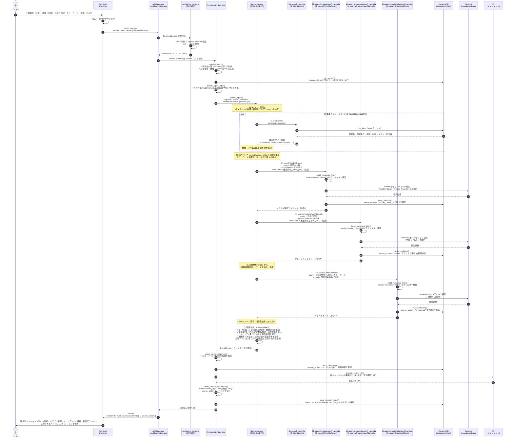

# トラブルシュートエージェント 処理シーケンス

> **状態:** Phase 3 の開発・参照資料。2026-09-30 に AWS stack / API / Lambda / table の存在は確認したが、利用者向け提供と現在の全フローは未確認。過去の PoC E2E 記録はその確認時点の結果であり、現在の提供状態を示さない。

> 最終検証: 2026-09-30 — AWS CloudFormation による Phase 3 リソース存在のみ。シーケンスの全機能・利用者向け E2E は未検証。

## 概要

Bedrock Agent を中心に、ユーザ入力・DB取得結果・KB検索結果を条件として次アクションを制御し、観点別に整理した回答と引用元バッジ付きドキュメントを提供する。

---

## 処理シーケンス図



---

## 条件分岐サマリ

| アクション | 実行条件 | 検索クエリ | フィルター |
|---|---|---|---|
| ① GetSiteInfo | 工事番号あり | constructionNumber | — |
| ② searchTroubleCases | 常に実行 | 不具合内容 | control-system=VFGLF ＋ エラーコード（あれば） |
| ③ searchTroubleshootManuals | 常に実行 | 不具合内容 | control-system=VFGLF ＋ エラーコード（あれば） |
| ④ searchCMaterialDocs | 常に実行 | ②③結果からAgentが抽出したキーワード | control-system=VFGLF |

## 機種（model）の優先順位

```
① GetSiteInfo の取得値
      ↓ なければ
ユーザ入力の機種
      ↓ なければ
フィルターなしで検索
```

## source_action タグと UI バッジの対応

| source_action | UI バッジ | 取得元 |
|---|---|---|
| `trouble_cases` | ② | `kb-search-cases-{env}` Lambda |
| `manual` | ③ | `kb-search-manuals-{env}` Lambda（★ write_citations を新規追加） |
| `c_material` | ④ | `kb-search-materials-{env}` Lambda |

> サイト情報（①）はドキュメント引用ではなく DB テキストのため、バッジ対象外。回答本文の「サイト情報」セクションに表示する。

## 既存実装からの主な変更点

| 変更対象 | 変更内容 |
|---|---|
| Bedrock Agent システムプロンプト | 条件分岐ロジック・機種優先順位・④のクエリ生成方法を指示として追加 |
| kb-search1 | citations に `source_action = "trouble_cases"` を追加 |
| kb-search2 | `write_citations()` を新規実装、`source_action = "manual"` を付与 |
| kb-search3 | citations に `source_action = "c_material"` を追加 |
| orchestrator | `build_source_documents()` で `source_action` フィールドを保持 |
| frontend | sourceDocuments の `source_action` を元に ② ③ ④ バッジを表示 |
